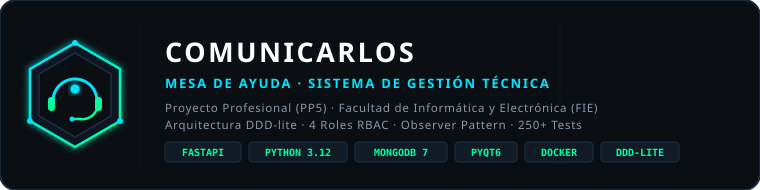
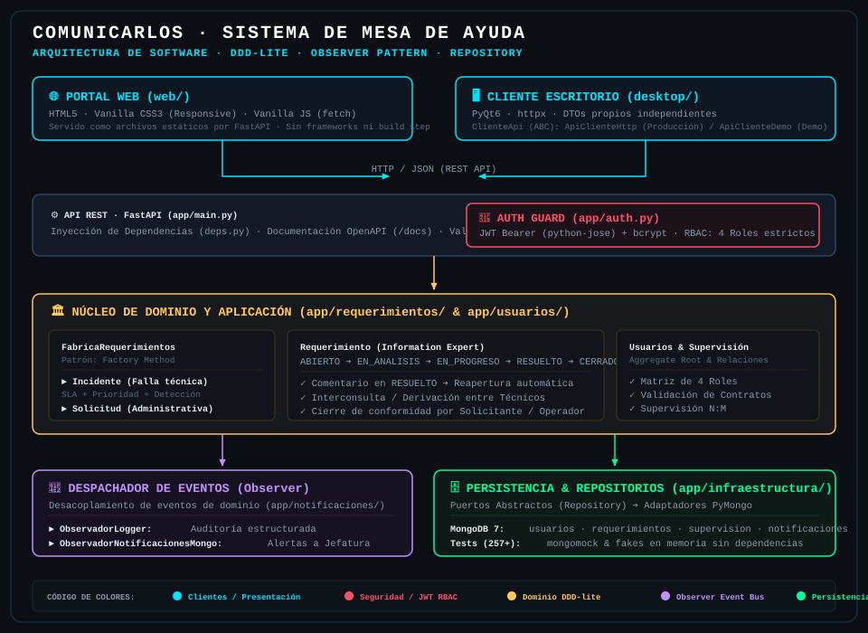

<p align="center">
  
</p>

# 🎧 Mesa de Ayuda — Cooperativa Comunicarlos

## Sistema de Gestión de Incidentes y Servicios (FIE PP5)

> **Sistema integral de Help Desk & IT Service Management para servicios de telecomunicaciones (Fibra Óptica, Telefonía IP, TV), construido con arquitectura DDD-lite, API REST FastAPI, clientes Web/Desktop y persistencia en MongoDB.**

**Descripción académica:** Proyecto Profesional (PP5) para la Facultad de Informática y Electrónica (FIE). Modela el ciclo de vida completo de atención técnica mediante roles estrictos (Solicitante, Operador, Técnico, Supervisor), validación de suscripciones de telecomunicaciones, derivación entre técnicos (interconsulta), reapertura automática auditada y despacho de eventos en tiempo real mediante el patrón Observer.

> ℹ️ **Estado del Proyecto:** Prototipo funcional completo con **257 tests automatizados**, clientes Web y Desktop operativos, y suite de diagramas UML/arquitectura interactiva en `docs/diagramas/`.

---

## ⚡ Features

| Feature / Módulo | Descripción Técnica | Estado |
|---|---|---|
| **Arquitectura DDD-lite** | Dominio rico con validación de transiciones en las propias entidades (`Information Expert`) | ✅ Implementado |
| **Jerarquía Polimórfica** | `Incidente` (urgencia, SLA, pasos) y `Solicitud` (gestión administrativa) instanciados por `Factory Method` | ✅ Implementado |
| **RBAC Estricto (4 Roles)** | Solicitante, Operador, Técnico y Supervisor con permisos granulares enforced en el backend | ✅ Implementado |
| **Auth Segura** | JWT (Bearer Tokens vía python-jose) + hash de contraseñas con bcrypt | ✅ Implementado |
| **Ciclo de Vida de Tickets** | `ABIERTO` ➔ `EN_ANALISIS` ➔ `EN_PROGRESO` ➔ `RESUELTO` ➔ `CERRADO` | ✅ Implementado |
| **Reapertura Automática** | Comentar sobre un ticket `RESUELTO` lo regresa a `EN_PROGRESO` disparando evento `REAPERTURA` | ✅ Implementado |
| **Derivación (Interconsulta)**| Un técnico asignado puede transferir el ticket a otro técnico especializado | ✅ Implementado |
| **Observer Event Bus** | `DespachadorEventos` notifica en tiempo real a `ObservadorLogger` y `ObservadorNotificacionesMongo` | ✅ Implementado |
| **Portal Web Responsive** | HTML5 + Vanilla CSS + Vanilla JS (`fetch`), servido estático sin frameworks ni build step | ✅ Fases 1 a 4 completas |
| **Cliente Escritorio PyQt6** | Cliente nativo con soporte de Modo Conectado (`ApiClienteHttp`) y Modo Demo (`ApiClienteDemo`) | ✅ Implementado |
| **Persistencia NoSQL** | Repositorios desacoplados con PyMongo sobre MongoDB 7 | ✅ Implementado |
| **Testing & Calidad** | 257 tests (pytest + mongomock + fakes en memoria), `mypy --strict`, `ruff` | ✅ 257 PASS / 0 FAIL |
| **Suite de Diagramas** | Visor HTML interactivo unificado (Casos de Uso, Clases, Flujo y Secuencia) | ✅ [`docs/diagramas/`](docs/diagramas/README.md) |

---

## 🏗️ Architecture

<p align="center">
  
</p>

```
[ Portal Web (web/) ]        [ Cliente Desktop PyQt6 (desktop/) ]
         │                                    │
         └───────────────┬────────────────────┘
                         │ (HTTP / JSON REST)
                         ▼
┌────────────────────────────────────────────────────────┐
│ FastAPI API Gateway + Auth Guard (JWT Bearer + bcrypt) │
└────────────────────────┬───────────────────────────────┘
                         │
                         ▼
┌────────────────────────────────────────────────────────┐
│                 DOMINIO RICO (DDD-lite)                │
│                                                        │
│  FabricaRequerimientos ──► Incidente / Solicitud       │
│  Requerimiento (Expert) ──► Máquina de Estados         │
│  Usuarios & Supervisión ──► Validación de Contratos    │
└──────────────┬──────────────────────────┬──────────────┘
               │ (Eventos)                │ (Repositorios)
               ▼                          ▼
┌─────────────────────────────┐  ┌───────────────────────┐
│ DespachadorEventos Observer │  │ Puertos / Repositorio │
│ ├─► ObservadorLogger        │  │          │            │
│ └─► Notificaciones a Jefes  │  │ Adaptadores PyMongo   │
└─────────────────────────────┘  └──────────┬────────────┘
                                            │
                                            ▼
                                  [ MongoDB 7 Engine ]
```

### Principios y Patrones de Diseño Aplicados

- **Information Expert**: La entidad `Requerimiento` es la única responsable de validar sus transiciones de estado, los permisos del actor que las ejecuta, la incorporación de comentarios de seguimiento y las derivaciones técnicas.
- **Factory Method**: `FabricaRequerimientos` centraliza la creación y reconstitución polimórfica de `Incidente` (con SLA, urgencia y criticidad) y `Solicitud` (trámites de alta/baja de servicios).
- **Observer**: `DespachadorEventos` desacopla las consecuencias secundarias de los cambios de estado. `ObservadorLogger` genera trazas de auditoría y `ObservadorNotificacionesMongo` crea alertas persistidas para los supervisores a cargo del operador o técnico involucrado.
- **Repository & Dependency Inversion**: Los servicios de aplicación operan contra interfaces abstractas (`RepositorioUsuarios`, `RepositorioRequerimientos`, `RepositorioSupervision`, `RepositorioNotificaciones`). En runtime se usan adaptadores PyMongo, y en pruebas se inyectan implementaciones falsas en memoria (`tests/fakes.py`), permitiendo ejecutar los 257 tests en segundos sin necesidad de un motor MongoDB levantado.

Detalle de diagramas UML interactivos: [`docs/diagramas/README.md`](docs/diagramas/README.md)

---

## ⚖️ Matriz de Roles y Reglas de Negocio

El sistema aplica un control de acceso basado en roles (**RBAC estricto**). Las reglas se validan en el núcleo de dominio:

| Acción / Operación | Solicitante | Operador | Técnico | Supervisor |
|---|:---:|:---:|:---:|:---:|
| Crear requerimiento propio | ✅ | ✅ | ✅ | ✅ |
| Ver todos los requerimientos | ❌ *(solo propios)* | ✅ | ✅ | ✅ |
| Asignar técnico al ticket | ❌ | ✅ | ❌ | ✅ |
| Iniciar progreso del ticket | ❌ | ❌ | ✅ *(si asignado)* | ✅ |
| Marcar como RESUELTO | ❌ | ❌ | ✅ *(si asignado)* | ✅ |
| Dar cierre de conformidad | ✅ *(propios)* | ✅ | ❌ | ✅ |
| Cancelar / Desestimar | ✅ *(si ABIERTO)* | ✅ | ❌ | ✅ |
| Agregar comentario | ✅ *(propios)* | ✅ | ✅ *(si asignado)* | ❌ |
| Derivar a otro técnico | ❌ | ❌ | ✅ *(si asignado)* | ❌ |
| Administrar usuarios | ❌ | ❌ | ❌ | ✅ |
| Administrar supervisiones | ❌ | ❌ | ❌ | ✅ |
| Recibir notificaciones | ❌ | ❌ | ❌ | ✅ |

### Reglas Críticas del Ciclo de Vida:
1. `ABIERTO` solo puede pasar a `EN_ANALISIS` (por Operador/Supervisor) o `CANCELADO`.
2. `EN_ANALISIS` requiere que haya un técnico asignado para poder transicionar a `EN_PROGRESO`.
3. `EN_PROGRESO` solo pasa a `RESUELTO` mediante una **nota de resolución técnica descriptiva**.
4. **Reapertura automática:** Si un Operador o Técnico comenta sobre un ticket `RESUELTO`, este vuelve automáticamente a `EN_PROGRESO` (evento `REAPERTURA`).
5. **Derivación (Interconsulta):** Solo el Técnico actualmente asignado puede derivar el ticket a otro Técnico (`POST /requerimientos/{id}/derivar`) mientras el estado sea `EN_ANALISIS` o `EN_PROGRESO`.

---

## 📂 Repository Structure

```
APP-Mesa-de-Ayuda/
├── README.md                   # Documentación principal del repositorio
├── CLAUDE.md                   # Guía de contexto técnico y reglas de desarrollo
├── pyproject.toml · uv.lock    # Gestión determinista de dependencias con uv
├── Dockerfile                  # Imagen multi-stage (uv + non-root user)
├── docker-compose.yml          # Orquestación de API FastAPI + MongoDB 7
├── assets/                     # Recursos gráficos vectoriales (logo.svg, architecture.svg)
├── app/                        # Backend REST API (FastAPI + DDD-lite)
│   ├── main.py                 # Punto de entrada de la API y montaje de estáticos
│   ├── config.py               # Variables de entorno tipadas con Pydantic
│   ├── auth.py                 # Seguridad: hashing bcrypt y tokens JWT
│   ├── deps.py                 # Inyección de dependencias de FastAPI y validación RBAC
│   ├── errores.py              # Manejo centralizado de excepciones de dominio
│   ├── compartido/             # Tipos compartidos (RolUsuario, ServicioComunicarlos)
│   ├── usuarios/               # Dominio, Aggregate Root, servicios y router de Usuario
│   ├── requerimientos/         # Dominio rico: Requerimiento, Incidente, Solicitud, Estados
│   ├── supervision/            # Gestión de relaciones N:M Supervisor <-> Equipo técnico
│   ├── notificaciones/         # Entidad Notificación + Observer Event Bus
│   └── infraestructura/        # Conexión a MongoDB y repositorios PyMongo
├── desktop/                    # Cliente de escritorio desacoplado (PyQt6)
│   ├── main.py                 # Punto de entrada del cliente desktop
│   ├── api_client.py           # ClienteApi (ABC): ApiClienteHttp / ApiClienteDemo
│   ├── models.py               # DTOs propios del cliente desktop
│   └── views/                  # Vistas: LoginWindow, MainWindow
├── web/                        # Portal Web Responsive (HTML5 / Vanilla CSS / JS)
│   ├── index.html              # Login unificado con JWT en localStorage
│   ├── app.html                # Portal dinámico según rol (Fases 1 a 4)
│   ├── css/                    # Estilos CSS responsivos (móvil y escritorio)
│   └── js/                     # Lógica cliente (fetch a la API, sin frameworks)
├── docs/                       # Documentación técnica
│   └── diagramas/              # Suite interactiva (.html) y fuentes Mermaid (.mmd)
├── scripts/
│   └── seed_mongo.py           # Script idempotente de siembra de datos de prueba
├── bruno/                      # Colección completa de peticiones HTTP (Bruno)
└── tests/                      # Suite de 257 pruebas unitarias y de integración
```

---

## 🚀 Puesta en Marcha

### Requisitos Previos
- [uv](https://docs.astral.sh/uv/getting-started/installation/) instalado (o Python 3.12).
- Docker y Docker Compose (recomendado para ejecución integrada).

### 1. Clonar e Instalar Dependencias

```bash
git clone https://github.com/martincrespo77/APP-Mesa-de-Ayuda.git
cd APP-Mesa-de-Ayuda
uv sync
```

### 2. Configuración de Entorno

Copiar el archivo de plantilla:

```bash
cp .env.example .env
```

| Variable | Descripción | Valor por Defecto |
|---|---|---|
| `SECRET_KEY` | Clave secreta para firma criptográfica JWT | — *(Obligatoria)* |
| `ALGORITHM` | Algoritmo de firma de tokens | `HS256` |
| `EXPIRACION_MINUTOS` | Tiempo de vida del access token | `60` |
| `MONGODB_URL` | String de conexión a MongoDB | `mongodb://localhost:27017` |
| `MONGODB_DB_NAME` | Nombre de la base de datos | `mesa_de_ayuda` |

### 3. Levantar con Docker Compose (Recomendado)

```bash
docker compose up --build
```

Esto inicia:
- **MongoDB 7 (`mongo`)**: Puerto `27017` con healthcheck.
- **API FastAPI (`api`)**: Puerto `8000`, esperando la disponibilidad de la base de datos.

Verificar el estado del servicio:
```bash
curl http://localhost:8000/health
# {"status":"ok"}
```
Documentación interactiva Swagger: `http://localhost:8000/docs`

---

## 🧪 Datos de Prueba (Seed)

El script `scripts/seed_mongo.py` puebla MongoDB de forma idempotente con usuarios de cada rol, tickets en distintos estados y relaciones de supervisión:

```bash
# Desde el host con uv:
uv run python -m scripts.seed_mongo

# O dentro del contenedor Docker:
docker compose exec api python -m scripts.seed_mongo
```

### Credenciales de Acceso Universal (`Seed1234!`):

| Rol | Email | Propósito / Alcance |
|---|---|---|
| 👑 **Supervisor** | `sofia.jefa@comunicarlos.com.ar` | Métricas globales, supervisión N:M, notificaciones y usuarios |
| 🎧 **Operador** | `rosa.molina@comunicarlos.com.ar` | Bandeja general, triage, asignación de técnicos y comentarios |
| 🔧 **Técnico** | `ivan.rios@comunicarlos.com.ar` | Tickets asignados, diagnóstico, derivación y resolución |
| 🔧 **Técnico 2** | `marta.suarez@comunicarlos.com.ar` | Técnico de destino para probar la interconsulta/derivación |
| 👤 **Solicitante** | `lucia.gomez@comunicarlos.com` | Solicitante con abono a Fibra Óptica, TV y Telefonía |
| 👤 **Solicitante** | `marcos.diaz@comunicarlos.com` | Solicitante con abono a Internet Banda Ancha |

---

## 💻 Clientes de Acceso

### 1. Portal Web (Navegador y Móvil)
El portal web (`web/`) está optimizado para dispositivos móviles y de escritorio. Al estar servido por FastAPI, no requiere configurar CORS:

- **Desde la PC:** `http://localhost:8000`
- **Desde el Celular (misma red Wi-Fi o Tailscale):** `http://<IP_LOCAL>:8000`

### 2. Cliente de Escritorio (PyQt6)
Ubicado en `desktop/`, se comunica con la API vía HTTP y cuenta con dos modalidades:

```bash
# Modo Conectado (requiere API levantada):
uv run python -m desktop.main --url http://localhost:8000

# Modo Demostración (100% offline, datos en memoria):
uv run python -m desktop.main --demo
```

---

## 🔍 Verificación, Calidad y Tests

Ejecución de la suite completa de 257 pruebas automatizadas:

```bash
# Tests unitarios y de integración:
uv run pytest

# Verificación de formato y linter:
uv run ruff check .

# Tipado estático estricto:
uv run mypy app/ desktop/
```

### Pruebas de API con Bruno
En la carpeta `bruno/` se encuentra la colección para ejecutar flujos de prueba automatizados:

```bash
npx @usebruno/cli run bruno --env local
```

---

## 📊 Documentación de Arquitectura

El sistema incluye una suite de diagramas UML interactivos en [`docs/diagramas/`](docs/diagramas/README.md).

Para visualizar la arquitectura completa con soporte de filtrado y simulación de escenarios, abre directamente en tu navegador:
👉 **[`docs/diagramas/diagrama_suite_unificada.html`](docs/diagramas/diagrama_suite_unificada.html)**
