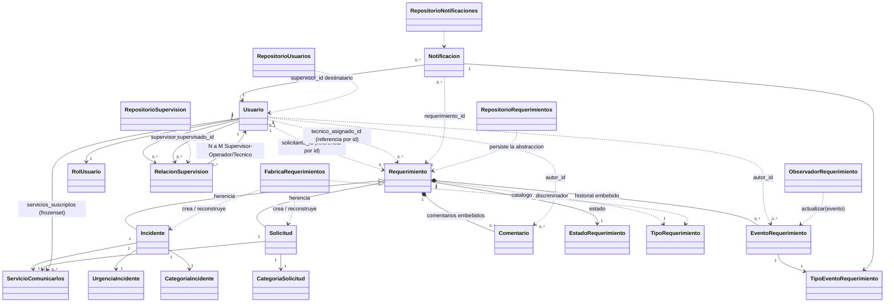
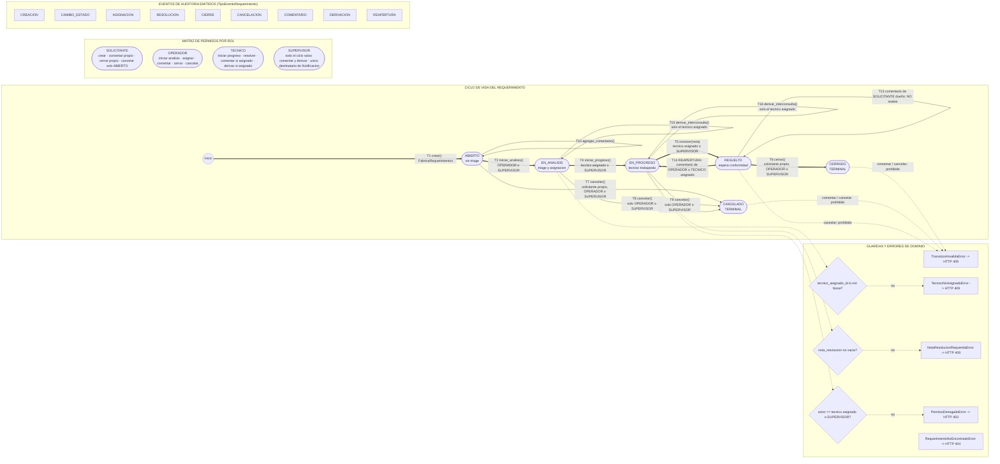

# Plan Maestro de Diagramación Técnica Interactiva
## Sistema «Mesa de Ayuda — Cooperativa Comunicarlos» (PP5)

> **Documento de especificación para modelos de ejecución.**
> Destinatarios: modelos ejecutores (Claude Sonnet, Gemini Pro u otros) que dispongan del
> servidor MCP `mcp-diagrama-iterativo-mermaid`.
> Autor del plan: fase de análisis sobre el repositorio local `/home/Ghost/PP5final`.
> Fecha de redacción: **2026-09-18**.
> Estado del repo al momento del análisis: rama `main`, commit `bad6f08`, árbol limpio.

---

## 0. Cómo usar este documento

Este Plan Maestro contiene **4 sub-planes independientes y auto-contenidos**. Cada sub-plan
produce **un (1) artefacto HTML interactivo autónomo** generado por el MCP
`mcp-diagrama-iterativo-mermaid`, más **un (1) archivo fuente `.mmd`** versionable.

Reglas globales, de cumplimiento obligatorio para el ejecutor:

1. **No inventar componentes.** Todo nodo del diagrama debe corresponder a un archivo, clase,
   función, endpoint, colección de Mongo, contenedor Docker o regla de firewall que **existe
   realmente** en el repositorio. Los nombres de nodos usan la nomenclatura exacta del código
   (español, como todo el proyecto).
2. **Verificar antes de dibujar.** Antes de emitir el Mermaid DSL, el ejecutor debe abrir y leer
   los archivos listados en la sección «Insumos de lectura obligatoria» del sub-plan que esté
   ejecutando. Si un archivo listado no existe o cambió, se documenta la desviación en el informe
   final en lugar de improvisar.
3. **Un sub-plan por vez.** Se ejecuta, se genera el HTML, se valida contra los criterios de
   aceptación y recién entonces se pasa al siguiente. No se fusionan diagramas.
4. **Idioma**: etiquetas de nodos en español, igual que el código. Los identificadores internos
   de nodo Mermaid van en `snake_case` ASCII sin tildes (ver §0.3).
5. **Sin dependencias externas.** El artefacto resultante es air-gapped por diseño del MCP: no se
   agregan CDNs, ni `<script src="https://...">`, ni fuentes remotas.

### 0.1 Herramientas MCP disponibles y su firma exacta

| Herramienta | Parámetros | Uso en este plan |
|---|---|---|
| `mcp-diagrama-iterativo-mermaid.analizar_proyecto` | `project_path: str` | **Paso 0 opcional** de reconocimiento. Devuelve stack, capas y diagramas preexistentes. Su salida **no reemplaza** la lectura de archivos exigida por cada sub-plan. |
| `mcp-diagrama-iterativo-mermaid.generar_diagrama_desde_mermaid` | `mermaid_code: str`, `output_path: str`, `titulo: str = "Diagrama Interactivo"` | **Herramienta principal de los 4 sub-planes.** Compila el DSL redactado a mano en un HTML interactivo de un solo archivo. |
| `mcp-diagrama-iterativo-mermaid.convertir_archivo_mermaid` | `input_file: str`, `output_path: str = ""` | Alternativa: si el ejecutor guarda primero el `.mmd`, puede compilarlo desde disco. Aceptable siempre que el `.mmd` quede versionado. |
| `mcp-diagrama-iterativo-mermaid.crear_diagrama_proyecto` | `project_path: str`, `output_path: str = ""`, `titulo: str = ""` | **Prohibida como entregable de los sub-planes 1-4.** Genera un diagrama automático genérico, sin la fidelidad de dominio que este plan exige. Solo se admite como material de contraste exploratorio. |

**Capacidades del renderer** (a tener en cuenta al diseñar el DSL): conectores SVG dinámicos con
cálculo perimétrico (`atan2`), drag & drop de nodos con redibujado, paneo, zoom, minimapa,
**filtros por capas/subgrafos** y **modal de inspección por nodo**. Consecuencias de diseño:

- Los **subgrafos son la unidad de filtrado** de la UI ⇒ agrupar con intención, no por estética.
- El **texto de la etiqueta del nodo es lo que se ve en el modal** ⇒ las etiquetas deben ser
  informativas y auto-explicativas (nombre técnico + ruta o responsabilidad), no siglas.
- El drag & drop implica que la posición no es semántica ⇒ **toda la semántica va en la etiqueta
  de la arista**, nunca en la disposición espacial.

### 0.2 Sintaxis Mermaid soportada y política de fallback

El compilador del MCP declara soporte para: **`flowchart` / `graph`, `erDiagram`, `classDiagram`**.

> [!IMPORTANT]
> **`stateDiagram-v2` NO figura en la lista de gramáticas soportadas.** Por lo tanto:
> - Sub-planes 1 y 2 → `graph TD` / `graph LR` (obligatorio).
> - Sub-plan 3 → `classDiagram` (obligatorio).
> - Sub-plan 4 → **`graph LR` emulando máquina de estados** (obligatorio). El ejecutor
>   *puede* generar adicionalmente una variante `stateDiagram-v2` como archivo `.mmd` de
>   referencia documental, pero **el HTML entregable se compila desde la variante `graph LR`**.
>   Si el ejecutor prueba `stateDiagram-v2` y el MCP lo compila correctamente, debe entregar
>   **ambos** HTML y declararlo en el informe.

### 0.3 Convenciones de identificadores y estilo

- **IDs de nodo**: `snake_case`, ASCII, sin tildes ni `ñ`, prefijados por capa.
  Ejemplos: `cli_desktop`, `api_router_req`, `dom_requerimiento`, `infra_repo_req_mongo`,
  `db_col_requerimientos`, `st_en_analisis`.
- **Etiquetas**: entre comillas dobles siempre que contengan espacios, paréntesis, barras,
  dos puntos o tildes → `nodo["ServicioRequerimientos<br/>app/requerimientos/servicios.py"]`.
  Usar `<br/>` para salto de línea. **No** usar comillas dobles dentro de la etiqueta; si hace
  falta comillar, usar `'` simple.
- **Formas por rol semántico** (uniformes en los 4 diagramas):

  | Forma Mermaid | Significado |
  |---|---|
  | `id["texto"]` rectángulo | Módulo, archivo, clase concreta |
  | `id("texto")` redondeado | Proceso/servicio de aplicación |
  | `id(["texto"])` estadio | Estado del ciclo de vida, actor humano |
  | `id[["texto"]]` subrutina | Router / endpoint agrupado |
  | `id[("texto")]` cilindro | Base de datos, colección Mongo |
  | `id{{"texto"}}` hexágono | Frontera de seguridad / red / firewall |
  | `id{"texto"}` rombo | Decisión, guarda de permiso |
  | `id[/"texto"/]` paralelogramo | DTO / schema de transporte |

- **Tipos de arista** (uniformes en los 4 diagramas):

  | Sintaxis | Semántica |
  |---|---|
  | `A --> B` | Dependencia/llamada síncrona directa |
  | `A -->|"etiqueta"| B` | Llamada con protocolo o método explícito |
  | `A -.-> B` | Dependencia indirecta, desacoplada o por inversión de dependencias (puerto/adaptador, Observer) |
  | `A ==> B` | Flujo principal de datos / camino feliz destacado |
  | `A -.->|"implementa"| B` | Realización de interfaz abstracta (ABC) |

- **Paleta por capa** (via `classDef`, obligatoria y consistente entre los 4 diagramas):

  ```
  classDef capaCliente    fill:#1e3a5f,stroke:#4a90d9,stroke-width:2px,color:#eaf2fb
  classDef capaRed        fill:#4a2d0a,stroke:#d99a4a,stroke-width:2px,color:#fdf3e6
  classDef capaApi        fill:#0f3d2e,stroke:#3fbf8f,stroke-width:2px,color:#e8fbf4
  classDef capaAplicacion fill:#123a4d,stroke:#39a8d0,stroke-width:2px,color:#e7f7fd
  classDef capaDominio    fill:#3d2a5c,stroke:#a179e0,stroke-width:2px,color:#f3ecff
  classDef capaInfra      fill:#4a1f2b,stroke:#d9647f,stroke-width:2px,color:#fdeaef
  classDef capaDatos      fill:#2b2b2b,stroke:#9e9e9e,stroke-width:2px,color:#f0f0f0
  classDef capaEventos    fill:#553d0a,stroke:#e0b73f,stroke-width:2px,color:#fff8e1
  ```

  Asignación al final del bloque DSL con `class id1,id2,id3 capaDominio`.

### 0.4 Rutas de salida (crear los directorios si no existen)

```
docs/diagramas/01_arquitectura_global.mmd
docs/diagramas/01_arquitectura_global.html
docs/diagramas/02_arquitectura_modular_ddd.mmd
docs/diagramas/02_arquitectura_modular_ddd.html
docs/diagramas/03_modelo_dominio_clases.mmd
docs/diagramas/03_modelo_dominio_clases.html
docs/diagramas/04_maquina_estados_requerimiento.mmd
docs/diagramas/04_maquina_estados_requerimiento.html
```

`docs/diagramas/` ya existe en el repo y está vacío. Todos los `output_path` que reciba el MCP
deben ser **absolutos**: `/home/Ghost/PP5final/docs/diagramas/<archivo>.html`.

### 0.5 Hechos verificados del repositorio (base común de los 4 sub-planes)

Datos confirmados por inspección directa; el ejecutor los toma como verdad de referencia.

**Stack** (`pyproject.toml`): Python ≥3.12 · FastAPI ≥0.110 · Pydantic v2 (`pydantic[email]`) ·
`pydantic-settings` · PyMongo ≥4.7 · `python-jose[cryptography]` (JWT) · `bcrypt` ≥4.0 ·
`uvicorn[standard]` · `python-multipart` · `httpx` ≥0.28 · `PyQt6` ≥6.6.
Dev: `pytest`, `mongomock`, `ruff` (line-length 100, reglas `E,F,I,UP,B,C4,SIM`), `mypy --strict`.

**Volumen de tests**: 231 funciones `test_*` distribuidas en 17 archivos bajo `tests/`
(`test_requerimientos_dominio.py` es el mayor, con 51). El README declara «232 tests».

**Superficie HTTP completa** (26 operaciones):

| Método | Ruta | Archivo | Gate de acceso |
|---|---|---|---|
| GET | `/health` | `app/main.py::verificar_salud` | público |
| POST | `/usuarios/login` | `app/usuarios/router.py::login` | público (OAuth2 form) |
| POST | `/usuarios/registro` | `app/usuarios/router.py::registrarse` | público (siempre crea SOLICITANTE) |
| GET | `/usuarios/me` | `app/usuarios/router.py::obtener_mi_perfil` | autenticado |
| GET | `/usuarios/tecnicos` | `app/usuarios/router.py::listar_tecnicos` | `requerir_rol(OPERADOR, TECNICO, SUPERVISOR)` |
| POST | `/usuarios` | `app/usuarios/router.py::crear_usuario` | `requerir_rol(SUPERVISOR)` |
| GET | `/usuarios` | `app/usuarios/router.py::listar_usuarios` | `requerir_rol(SUPERVISOR)` |
| PATCH | `/usuarios/{usuario_id}/rol` | `app/usuarios/router.py::cambiar_rol` | `requerir_rol(SUPERVISOR)` |
| PATCH | `/usuarios/{usuario_id}/activar` | `app/usuarios/router.py::activar_usuario` | `requerir_rol(SUPERVISOR)` |
| PATCH | `/usuarios/{usuario_id}/desactivar` | `app/usuarios/router.py::desactivar_usuario` | `requerir_rol(SUPERVISOR)` |
| POST | `/requerimientos` | `app/requerimientos/router.py::crear_requerimiento` | autenticado |
| GET | `/requerimientos` | `…::listar_requerimientos` | autenticado + visibilidad por rol |
| GET | `/requerimientos/{id}` | `…::obtener_requerimiento` | autenticado + propiedad |
| POST | `/requerimientos/{id}/iniciar-analisis` | `…::iniciar_analisis` | validado en la **entidad** |
| POST | `/requerimientos/{id}/asignar-tecnico` | `…::asignar_tecnico` | validado en la entidad |
| POST | `/requerimientos/{id}/iniciar-progreso` | `…::iniciar_progreso` | validado en la entidad |
| POST | `/requerimientos/{id}/resolver` | `…::resolver` | validado en la entidad |
| POST | `/requerimientos/{id}/cerrar` | `…::cerrar` | validado en la entidad |
| POST | `/requerimientos/{id}/cancelar` | `…::cancelar` | validado en la entidad |
| POST | `/requerimientos/{id}/comentarios` | `…::agregar_comentario` | validado en la entidad |
| POST | `/requerimientos/{id}/derivar` | `…::derivar_interconsulta` | validado en la entidad |
| POST | `/supervisiones` | `app/supervision/router.py::asignar_supervision` | `requerir_rol(SUPERVISOR)` a nivel router |
| DELETE | `/supervisiones/{supervisado_id}` | `…::remover_supervision` | `requerir_rol(SUPERVISOR)` |
| GET | `/supervisiones` | `…::listar_mis_supervisados` | `requerir_rol(SUPERVISOR)` |
| GET | `/notificaciones` | `app/notificaciones/router.py::listar_mis_notificaciones` | `requerir_rol(SUPERVISOR)` |
| PATCH | `/notificaciones/{id}/leida` | `…::marcar_notificacion_leida` | `requerir_rol(SUPERVISOR)` |

Más el montaje estático: `app.mount("/", StaticFiles(directory="web", html=True), name="web")`,
**registrado al final** para que los routers resuelvan primero.

**Colecciones MongoDB** (`app/infraestructura/database.py`): `usuarios`, `requerimientos`,
`supervisiones`, `notificaciones`. Índices creados en `crear_indices(db)`:
`usuarios.email` (unique), `requerimientos.solicitante_id`, `requerimientos.estado`,
`requerimientos.tipo`, `supervisiones.supervisor_id`, `supervisiones.supervisado_id`,
`notificaciones.supervisor_id`. El `_id` es el UUID de dominio serializado como string.

> [!WARNING]
> **Corrección de nomenclatura respecto del encargo original.** El enunciado del sub-plan 4
> menciona los estados `NUEVO, ASIGNADO, EN_PROCESO, RESUELTO, CERRADO, RECHAZADO`.
> Esos nombres **no existen en el código**. La enumeración real es
> `EstadoRequerimiento` (`app/requerimientos/dominio/estados.py`):
> **`ABIERTO, EN_ANALISIS, EN_PROGRESO, RESUELTO, CERRADO, CANCELADO`**.
> Además **no existe un estado `ASIGNADO`**: la asignación de técnico es un evento
> (`TipoEventoRequerimiento.ASIGNACION`) que ocurre **dentro** de `EN_ANALISIS` sin cambiar el
> estado. Y **no existe `NUEVO`**: el ticket nace directamente en `ABIERTO` (documentado
> explícitamente en el docstring de `estados.py`).
> **El sub-plan 4 de este documento usa la nomenclatura real** e incluye una tabla de mapeo
> para trazabilidad con el encargo. Los ejecutores **no deben** usar los nombres del encargo.
>
> Idéntica corrección para los roles: el encargo dice «Usuario»; el rol real es
> **`SOLICITANTE`** (`RolUsuario` en `app/compartido/dominio.py`).

---

# SUB-PLAN 1 — Diagrama de Arquitectura Global, Contenedores y Red

## 1.1 Objetivo

Producir la **vista de despliegue y comunicación de extremo a extremo**: qué clientes existen,
por qué canal hablan con el backend, qué frontera de red/seguridad atraviesan, cómo está
empaquetado y orquestado el backend en Docker, y dónde persisten los datos.

Es el diagrama de nivel más alto: responde «¿qué procesos corren, en qué contenedor, escuchando
en qué puerto, y quién puede llegar a ellos?». **No** debe entrar en el detalle de módulos
internos de `app/` (eso es el sub-plan 2) ni en clases de dominio (sub-plan 3).

## 1.2 Contexto verificado

- Tres clientes heterogéneos comparten **una única API HTTP/JSON**: portal web estático,
  cliente PyQt6 de escritorio y la colección Bruno de pruebas manuales.
- **Mismo origen** para el portal web: FastAPI sirve `web/` como estáticos en `/`, por lo que
  **no hay configuración de CORS en todo el proyecto** (hecho verificable: `grep -r CORS app/`
  no devuelve resultados). Este es un punto arquitectónico que **debe quedar anotado en el
  diagrama** (nodo de nota o etiqueta de arista).
- El cliente de escritorio es **desacoplado por contrato, no por importación**: `desktop/` no
  importa nada de `app/`; replica los enums y define DTOs propios en `desktop/models.py`.
- El acceso desde el celular está restringido por `iptables` a una única IP de Tailscale.

## 1.3 Insumos de lectura obligatoria

| Archivo | Qué extraer |
|---|---|
| `docker-compose.yml` | servicios `mongo` y `api`, puertos, healthcheck, `depends_on: service_healthy`, volumen `mongo_data`, variables de entorno |
| `Dockerfile` | multi-stage `build`→`runtime`, `uv` 0.8.21, usuario `appuser` (uid 1001), `EXPOSE 8000`, `ENTRYPOINT uvicorn app.main:app --host 0.0.0.0 --port 8000` |
| `app/main.py` | `lifespan`, `app.state.db`, orden de `include_router`, `app.mount("/", StaticFiles(...))`, `exception_handler(DominioError)`, `GET /health` |
| `app/config.py` | `Settings`: `SECRET_KEY`, `MONGODB_URL`, `MONGODB_DB_NAME`, `ALGORITHM="HS256"`, `EXPIRACION_MINUTOS=60`; `get_settings()` con `@lru_cache` |
| `app/auth.py` | `obtener_password_hash`/`verificar_password` (bcrypt), `crear_token_acceso`, `decodificar_token`, claims `sub`/`rol`/`exp`, `TokenInvalidoError` |
| `app/deps.py` | `OAuth2PasswordBearer(tokenUrl="/usuarios/login")`, `obtener_usuario_actual`, `requerir_rol` |
| `app/infraestructura/database.py` | `crear_cliente_mongo(tz_aware=True)`, `obtener_base_datos`, `crear_indices`, nombres de las 4 colecciones |
| `web/index.html`, `web/app.html`, `web/js/api.js`, `web/js/login.js`, `web/js/app.js`, `web/css/estilos.css` | archivos servidos, uso de `localStorage`, `apiFetch`/`apiFetchJson`, manejo de 401 |
| `desktop/main.py`, `desktop/api_client.py`, `desktop/models.py`, `desktop/views/*.py`, `desktop/styles.py` | `ClienteApi` (ABC), `ApiClienteHttp` (httpx), `ApiClienteDemo`, DTOs, `LoginWindow`, `MainWindow`, flag `--demo`, `--url` |
| `scripts/firewall_tailscale.sh` | `PHONE_IP=100.109.79.72`, `APP_PORT=8000`, cadenas `DOCKER-USER` e `INPUT`, comentarios `APP_MESA_*`, subcomandos `apply|clear|status` |
| `scripts/seed_mongo.py` | acceso directo por repositorios PyMongo, sin pasar por HTTP ni por servicios |
| `bruno/bruno.json`, `bruno/environments/local.bru`, `bruno/0*/**.bru` | `base_url=http://localhost:8000`, 4 carpetas de colección, credenciales de seed |
| `README.md` | secciones de arranque, portal web y modo demo |

## 1.4 Inventario exacto de nodos

### Subgrafo `sg_clientes` — «Clientes (consumidores de la API)»

| ID | Forma | Etiqueta sugerida |
|---|---|---|
| `cli_navegador` | estadio | `Navegador de escritorio / Celular<br/>(Chrome, Safari, Firefox)` |
| `cli_web_index` | rect | `web/index.html<br/>Login + auto-registro de Solicitante` |
| `cli_web_app` | rect | `web/app.html<br/>Portal SPA-lite: 5 pestañas por rol` |
| `cli_web_apijs` | rect | `web/js/api.js<br/>apiFetch / apiFetchJson · JWT en localStorage · corte de sesion en 401` |
| `cli_web_loginjs` | rect | `web/js/login.js<br/>POST /usuarios/login (form-urlencoded) + POST /usuarios/registro` |
| `cli_web_appjs` | rect | `web/js/app.js<br/>Render por rol · funciones puede*(ticket) · sin framework ni build` |
| `cli_web_css` | rect | `web/css/estilos.css<br/>CSS vanilla responsivo` |
| `cli_desktop_main` | rect | `desktop/main.py<br/>QApplication · flags --demo y --url` |
| `cli_desktop_login` | rect | `desktop/views/login_window.py<br/>LoginWindow · signal sesion_iniciada` |
| `cli_desktop_mainwin` | rect | `desktop/views/main_window.py<br/>MainWindow (QTabWidget): Requerimientos / Nuevo / Notificaciones` |
| `cli_desktop_puerto` | rect | `desktop/api_client.py::ClienteApi (ABC)<br/>Puerto abstracto del cliente` |
| `cli_desktop_http` | rect | `desktop/api_client.py::ApiClienteHttp<br/>httpx.Client · Bearer JWT · timeout 10s` |
| `cli_desktop_demo` | rect | `desktop/api_client.py::ApiClienteDemo<br/>Modo Demostracion offline · sin red` |
| `cli_desktop_dtos` | paralelogramo | `desktop/models.py<br/>UsuarioDTO · RequerimientoDTO · EventoDTO + enums propios` |
| `cli_bruno` | rect | `bruno/ · 4 carpetas · 39 requests .bru + environments/local.bru<br/>base_url=http://localhost:8000` |

### Subgrafo `sg_red` — «Red y perímetro de seguridad»

| ID | Forma | Etiqueta sugerida |
|---|---|---|
| `red_tailscale` | hexágono | `Red Tailscale (WireGuard)<br/>Celular autorizado: 100.109.79.72` |
| `red_firewall` | hexágono | `scripts/firewall_tailscale.sh<br/>iptables · apply / clear / status` |
| `red_chain_docker` | hexágono | `Cadena DOCKER-USER<br/>ACCEPT conntrack · ACCEPT 100.109.79.72:8000 · ACCEPT 127.0.0.1:8000 · DROP resto` |
| `red_chain_input` | hexágono | `Cadena INPUT<br/>mismas 4 reglas APP_MESA_* sobre docker-proxy` |
| `red_loopback` | hexágono | `127.0.0.1 (host local)<br/>Desarrollo, Bruno, seed y desktop` |
| `red_puerto_8000` | hexágono | `Puerto publicado 8000/tcp<br/>unico punto de entrada de la aplicacion` |

### Subgrafo `sg_docker` — «Orquestación Docker Compose»

| ID | Forma | Etiqueta sugerida |
|---|---|---|
| `dock_compose` | rect | `docker-compose.yml<br/>servicios: mongo, api · volumen mongo_data` |
| `dock_dockerfile` | rect | `Dockerfile (multi-stage)<br/>build: python:3.12-slim + uv 0.8.21 (uv sync --frozen --no-dev)` |
| `dock_runtime` | rect | `Etapa runtime<br/>usuario no-root appuser (uid 1001) · EXPOSE 8000` |
| `dock_entrypoint` | proceso | `ENTRYPOINT uvicorn app.main:app --host 0.0.0.0 --port 8000` |
| `dock_svc_api` | rect | `Servicio api<br/>ports 8000:8000 · restart unless-stopped · depends_on mongo (service_healthy)` |
| `dock_svc_mongo` | rect | `Servicio mongo (mongo:7)<br/>ports 127.0.0.1:27017 · healthcheck db.adminCommand('ping') cada 5s` |
| `dock_volumen` | cilindro | `Volumen mongo_data<br/>/data/db persistente` |
| `dock_env` | paralelogramo | `Variables de entorno<br/>MONGODB_URL · MONGODB_DB_NAME=mesa_de_ayuda · SECRET_KEY` |

### Subgrafo `sg_api` — «Backend FastAPI (proceso uvicorn)»

| ID | Forma | Etiqueta sugerida |
|---|---|---|
| `api_app` | proceso | `app/main.py<br/>FastAPI(title='Mesa de Ayuda - Cooperativa Comunicarlos')` |
| `api_lifespan` | proceso | `lifespan(app)<br/>crear_cliente_mongo -> obtener_base_datos -> crear_indices -> app.state.db` |
| `api_health` | subrutina | `GET /health<br/>verificar_salud() -> {'status':'ok'}` |
| `api_handler_err` | rombo | `exception_handler(DominioError)<br/>errores.codigo_http_para -> 401/403/404/409/400` |
| `api_router_usuarios` | subrutina | `router_usuarios · prefix /usuarios<br/>login · registro · me · tecnicos · CRUD (9 endpoints)` |
| `api_router_req` | subrutina | `router_requerimientos · prefix /requerimientos<br/>alta · listado · detalle · 8 transiciones (11 endpoints)` |
| `api_router_sup` | subrutina | `router_supervision · prefix /supervisiones<br/>3 endpoints · router gateado a SUPERVISOR` |
| `api_router_notif` | subrutina | `router_notificaciones · prefix /notificaciones<br/>2 endpoints · router gateado a SUPERVISOR` |
| `api_static` | rect | `app.mount('/', StaticFiles(directory='web', html=True))<br/>montado ULTIMO: los routers resuelven primero` |
| `api_config` | paralelogramo | `app/config.py::Settings<br/>SECRET_KEY · MONGODB_URL · MONGODB_DB_NAME · HS256 · 60 min` |
| `api_auth` | rect | `app/auth.py<br/>bcrypt hashpw/checkpw · jose jwt encode/decode · claims sub, rol, exp` |
| `api_deps` | rect | `app/deps.py<br/>OAuth2PasswordBearer(tokenUrl='/usuarios/login') · obtener_usuario_actual · requerir_rol` |

### Subgrafo `sg_datos` — «Persistencia MongoDB 7»

| ID | Forma | Etiqueta sugerida |
|---|---|---|
| `db_cliente` | rect | `PyMongo MongoClient(tz_aware=True)<br/>pool unico creado en el lifespan` |
| `db_base` | cilindro | `Base de datos mesa_de_ayuda` |
| `db_col_usuarios` | cilindro | `usuarios<br/>indice unico: email` |
| `db_col_req` | cilindro | `requerimientos<br/>indices: solicitante_id, estado, tipo · historial y comentarios embebidos` |
| `db_col_sup` | cilindro | `supervisiones<br/>indices: supervisor_id, supervisado_id` |
| `db_col_notif` | cilindro | `notificaciones<br/>indice: supervisor_id` |

### Subgrafo `sg_operacion` — «Operación y datos de prueba»

| ID | Forma | Etiqueta sugerida |
|---|---|---|
| `ops_seed` | proceso | `scripts/seed_mongo.py<br/>docker compose exec api python -m scripts.seed_mongo · UUID5 deterministas` |
| `ops_tests` | rect | `tests/ (231 tests pytest)<br/>fakes.py en memoria + mongomock` |

## 1.5 Conexiones exactas a representar

```
%% --- Clientes hacia el borde de red ---
cli_navegador ==>|"HTTPS/HTTP sobre Tailscale"| red_tailscale
cli_navegador -->|"http://localhost:8000"| red_loopback
cli_desktop_main --> cli_desktop_login
cli_desktop_login -->|"signal sesion_iniciada(cliente, usuario)"| cli_desktop_mainwin
cli_desktop_login --> cli_desktop_puerto
cli_desktop_mainwin --> cli_desktop_puerto
cli_desktop_http -.->|"implementa"| cli_desktop_puerto
cli_desktop_demo -.->|"implementa (sin red)"| cli_desktop_puerto
cli_desktop_http --> cli_desktop_dtos
cli_desktop_http ==>|"httpx · Bearer JWT"| red_loopback
cli_bruno -->|"HTTP · vars de local.bru"| red_loopback

%% --- Portal web: archivos estaticos servidos por la propia API ---
cli_navegador --> cli_web_index
cli_navegador --> cli_web_app
cli_web_index --> cli_web_loginjs
cli_web_app --> cli_web_appjs
cli_web_loginjs --> cli_web_apijs
cli_web_appjs --> cli_web_apijs
cli_web_app --> cli_web_css
cli_web_apijs ==>|"fetch mismo origen · sin CORS"| red_puerto_8000

%% --- Perimetro ---
red_tailscale --> red_chain_input
red_tailscale --> red_chain_docker
red_loopback --> red_chain_input
red_firewall -->|"iptables -I ... APP_MESA_*"| red_chain_docker
red_firewall -->|"iptables -I ... APP_MESA_*"| red_chain_input
red_chain_docker -->|"ACCEPT 100.109.79.72 y 127.0.0.1 · DROP resto"| red_puerto_8000
red_chain_input -->|"ACCEPT 100.109.79.72 y 127.0.0.1 · DROP resto"| red_puerto_8000

%% --- Docker ---
red_puerto_8000 ==>|"publish 8000:8000"| dock_svc_api
dock_compose --> dock_svc_api
dock_compose --> dock_svc_mongo
dock_compose --> dock_volumen
dock_compose -->|"inyecta"| dock_env
dock_dockerfile --> dock_runtime
dock_runtime --> dock_entrypoint
dock_svc_api -->|"build: ."| dock_dockerfile
dock_svc_api -->|"depends_on: condition service_healthy"| dock_svc_mongo
dock_svc_mongo --> dock_volumen
dock_entrypoint ==> api_app
dock_env -.-> api_config

%% --- API interna (solo nivel de borde) ---
api_app --> api_lifespan
api_app --> api_health
api_app --> api_handler_err
api_app --> api_router_usuarios
api_app --> api_router_req
api_app --> api_router_sup
api_app --> api_router_notif
api_app -->|"mount ULTIMO en '/'"| api_static
api_static -.->|"sirve los archivos de web/"| cli_web_app
api_config --> api_auth
api_deps --> api_auth
api_router_usuarios -->|"crear_token_acceso / verificar_password"| api_auth
api_router_req --> api_deps
api_router_sup --> api_deps
api_router_notif --> api_deps
api_deps -.->|"lee request.app.state.db"| api_lifespan

%% --- Datos ---
api_lifespan ==>|"crear_cliente_mongo(settings)"| db_cliente
db_cliente -->|"mongodb://mongo:27017"| dock_svc_mongo
db_cliente --> db_base
db_base --> db_col_usuarios
db_base --> db_col_req
db_base --> db_col_sup
db_base --> db_col_notif
api_lifespan -.->|"crear_indices(db) idempotente"| db_base

%% --- Operacion ---
ops_seed ==>|"repositorios PyMongo directos, sin HTTP"| db_base
ops_tests -.->|"mongomock + dependency_overrides"| api_app
```

## 1.6 Esqueleto DSL de partida

```mermaid
graph TD
    subgraph sg_clientes["CLIENTES"]
        direction TB
        subgraph sg_web["Portal Web (web/) — Vanilla JS, sin build step"]
            cli_web_index["..."]
        end
        subgraph sg_desk["Cliente Escritorio (desktop/) — PyQt6 desacoplado"]
            cli_desktop_main["..."]
        end
        cli_bruno["..."]
    end
    subgraph sg_red["RED Y PERIMETRO DE SEGURIDAD"]
        red_tailscale{{"..."}}
    end
    subgraph sg_docker["DOCKER COMPOSE"]
        dock_svc_api["..."]
    end
    subgraph sg_api["BACKEND FastAPI (contenedor api)"]
        api_app("...")
    end
    subgraph sg_datos["MONGODB 7 (contenedor mongo)"]
        db_base[("...")]
    end
    subgraph sg_operacion["OPERACION"]
        ops_seed("...")
    end

    %% ... aristas de §1.5 ...

    classDef capaCliente fill:#1e3a5f,stroke:#4a90d9,stroke-width:2px,color:#eaf2fb
    %% ... resto de classDef de §0.3 ...
    class cli_navegador,cli_web_index,cli_web_app,cli_web_apijs,cli_web_loginjs,cli_web_appjs,cli_web_css,cli_desktop_main,cli_desktop_login,cli_desktop_mainwin,cli_desktop_puerto,cli_desktop_http,cli_desktop_demo,cli_desktop_dtos,cli_bruno capaCliente
    class red_tailscale,red_firewall,red_chain_docker,red_chain_input,red_loopback,red_puerto_8000 capaRed
    class dock_compose,dock_dockerfile,dock_runtime,dock_entrypoint,dock_svc_api,dock_svc_mongo,dock_volumen,dock_env capaInfra
    class api_app,api_lifespan,api_health,api_handler_err,api_router_usuarios,api_router_req,api_router_sup,api_router_notif,api_static,api_config,api_auth,api_deps capaApi
    class db_cliente,db_base,db_col_usuarios,db_col_req,db_col_sup,db_col_notif capaDatos
```



## 1.7 Llamada MCP

```json
{
  "tool": "mcp-diagrama-iterativo-mermaid.generar_diagrama_desde_mermaid",
  "arguments": {
    "titulo": "Mesa de Ayuda Comunicarlos — Arquitectura Global, Contenedores y Red",
    "output_path": "/home/Ghost/PP5final/docs/diagramas/01_arquitectura_global.html",
    "mermaid_code": "<DSL completo redactado según §1.4–§1.6>"
  }
}
```

Antes de la llamada, guardar el mismo DSL en
`/home/Ghost/PP5final/docs/diagramas/01_arquitectura_global.mmd`.

## 1.8 Criterios de aceptación (checklist de evaluación del ejecutor)

| # | Criterio | Peso |
|---|---|:--:|
| 1.A | Existen **exactamente 6 subgrafos** de primer nivel: clientes, red, docker, api, datos, operación (los sub-subgrafos web/desktop dentro de clientes son admisibles y deseables). | ★★ |
| 1.B | Los **tres clientes** están presentes y diferenciados: portal web, desktop PyQt6, Bruno. | ★★★ |
| 1.C | El desacople del desktop se ve estructuralmente: `ClienteApi` (ABC) con **dos** realizaciones (`ApiClienteHttp`, `ApiClienteDemo`) y `desktop/models.py` como DTOs propios, **sin ninguna arista de desktop hacia `app/`**. | ★★★ |
| 1.D | Aparece la IP exacta `100.109.79.72`, el puerto `8000` y **ambas cadenas** `DOCKER-USER` e `INPUT`. | ★★★ |
| 1.E | Se representa que el portal web se sirve desde la **misma instancia FastAPI** y que por eso **no hay CORS**, con el montaje estático marcado como **último** en el orden de registro. | ★★★ |
| 1.F | Docker aparece con: multi-stage, usuario no-root `appuser`, `ENTRYPOINT uvicorn app.main:app`, `depends_on … service_healthy`, healthcheck de mongo y volumen `mongo_data`. | ★★ |
| 1.G | Las **4 colecciones** Mongo están presentes con sus índices reales. | ★★ |
| 1.H | El `lifespan` está modelado como el punto único donde nace `MongoClient` y se dejan `app.state.db` + índices. | ★★ |
| 1.I | Los 4 routers figuran con su `prefix` y su cantidad de endpoints; `GET /health` figura aparte. | ★★ |
| 1.J | Paleta y formas respetan §0.3; todo nodo tiene `class` asignada. | ★ |
| 1.K | El HTML abre sin conexión a internet, permite arrastrar nodos, filtrar por subgrafo y abrir el modal de al menos 10 nodos distintos con texto legible. | ★★★ |
| 1.L | El `.mmd` quedó versionado junto al `.html`. | ★ |

**Rechazo automático si**: aparece un nodo «React/Vue/Node», una arista `desktop → app`, un nodo
de CORS activo, el estado `NUEVO`/`ASIGNADO`, o si se usó `crear_diagrama_proyecto` como
entregable.

---

# SUB-PLAN 2 — Diagrama de Arquitectura Modular DDD-lite (backend `app/`)

## 2.1 Objetivo

Producir la **vista de capas y dependencias internas del backend**: cómo una request HTTP
atraviesa Router → Dependencias → Servicio de Aplicación → Dominio → Puerto de Repositorio →
Adaptador PyMongo → MongoDB, y cómo el evento de dominio resultante viaja por el patrón
**Observer** hasta el log de auditoría y la colección `notificaciones`.

El diagrama debe hacer **visualmente evidente la regla de dependencias**: el dominio no depende de
nada hacia afuera; la infraestructura depende de las abstracciones del dominio (Dependency
Inversion); `notificaciones` depende de `requerimientos` y **nunca al revés**.

> [!NOTE]
> **Corrección de ruta respecto del encargo.** El encargo menciona
> `notificaciones/dominio/observer.py`. Ese archivo **no existe**. Las rutas reales son:
> - `app/notificaciones/observador.py` → `ObservadorRequerimiento` (ABC).
> - `app/notificaciones/despachador.py` → `DespachadorEventos` (Sujeto/Observable).
> - `app/notificaciones/observador_logger.py` → `ObservadorLogger`.
> - `app/infraestructura/observador_notificaciones.py` → `ObservadorNotificacionesMongo`.
> - `app/notificaciones/dominio.py` → entidad `Notificacion` (archivo plano, no paquete).
> Además, los nombres reales de los servicios son **plurales**: `ServicioRequerimientos`,
> `ServicioUsuarios`, `ServicioSupervision`, `ServicioNotificaciones` (el encargo decía
> «ServicioRequerimiento»/«ServicioUsuario»).

## 2.2 Insumos de lectura obligatoria

Los **46 módulos** de `app/` (archivos `.py` sin contar los `__init__.py`), agrupados por capa:

- **Composición/transversal**: `app/main.py`, `app/deps.py`, `app/config.py`, `app/auth.py`,
  `app/errores.py`.
- **Shared Kernel**: `app/compartido/dominio.py` (`RolUsuario`, `ServicioComunicarlos`),
  `app/compartido/excepciones.py` (`DominioError`).
- **Módulo `usuarios/`**: `router.py`, `schemas.py`, `servicios.py`, `dominio.py`,
  `repositorio.py`, `excepciones.py`.
- **Módulo `requerimientos/`**: `router.py`, `schemas.py`, `servicios.py`, `fabrica.py`,
  `eventos.py`, `repositorio.py`, `excepciones.py`, `dominio/{__init__,base,incidente,solicitud,comentario,estados}.py`.
- **Módulo `supervision/`**: `router.py`, `schemas.py`, `servicios.py`, `dominio.py`,
  `repositorio.py`, `excepciones.py`.
- **Módulo `notificaciones/`**: `router.py`, `schemas.py`, `servicios.py`, `dominio.py`,
  `observador.py`, `observador_logger.py`, `despachador.py`, `repositorio.py`, `excepciones.py`.
- **Infraestructura**: `app/infraestructura/{database,repo_usuarios,repo_requerimientos,repo_supervision,repo_notificaciones,observador_notificaciones}.py`.
- **Tests de contraste**: `tests/fakes.py` (implementaciones en memoria de los 4 puertos).

## 2.3 Hechos arquitectónicos que el diagrama debe transmitir

1. **Information Expert**: las transiciones **no** usan `requerir_rol(...)` en el router. La
   entidad `Requerimiento` valida estado + rol + identidad y lanza excepción de dominio. Solo los
   endpoints **sin contraparte de dominio** (administración de usuarios, supervisiones,
   notificaciones, `/usuarios/tecnicos`) usan `requerir_rol`.
2. **Traducción de errores centralizada**: `DominioError` sube sin `try/except` en routers y la
   traduce `app/errores.py::codigo_http_para` (recorre el MRO; default 400) desde el
   `exception_handler` de `app/main.py`.
3. **Factory Method**: `FabricaRequerimientos` con `_catalogo: dict[TipoRequerimiento, type[Requerimiento]]`
   y tres métodos: `crear`, `reconstruir`, `registrar_tipo` (extensible sin modificar la fábrica).
4. **Observer por request**: `deps.obtener_despachador_eventos` construye un `DespachadorEventos`
   **nuevo en cada request** y le suscribe `ObservadorLogger` + `ObservadorNotificacionesMongo`
   (este último necesita el `db` de la request).
5. **Dependency Inversion**: 4 puertos ABC en los módulos de dominio, 4 adaptadores PyMongo en
   `infraestructura/` y 4 fakes en `tests/fakes.py`.
6. **Serialización polimórfica en dos capas distintas**: Pydantic Discriminated Union (`tipo`) en
   `requerimientos/schemas.py` para HTTP, y diccionarios `_SERIALIZADORES`/`_DESERIALIZADORES` en
   `repo_requerimientos.py` para BSON.

## 2.4 Inventario exacto de nodos

### Subgrafo `sg_presentacion` — «Capa de Presentación (Routers + DTOs Pydantic)»

| ID | Forma | Etiqueta |
|---|---|---|
| `pres_main` | proceso | `app/main.py<br/>FastAPI · lifespan · include_router x4 · mount estatico` |
| `pres_errores` | rombo | `app/errores.py::codigo_http_para<br/>DominioError -> 401/403/404/409 (default 400 por MRO)` |
| `pres_router_usr` | subrutina | `usuarios/router.py<br/>login · registro · me · tecnicos · POST/GET · PATCH rol/activar/desactivar` |
| `pres_router_req` | subrutina | `requerimientos/router.py<br/>crear · listar · obtener · iniciar-analisis · asignar-tecnico · iniciar-progreso · resolver · cerrar · cancelar · comentarios · derivar` |
| `pres_router_sup` | subrutina | `supervision/router.py<br/>POST / DELETE /{supervisado_id} / GET · router-level requerir_rol(SUPERVISOR)` |
| `pres_router_notif` | subrutina | `notificaciones/router.py<br/>GET · PATCH /{id}/leida · router-level requerir_rol(SUPERVISOR)` |
| `pres_schemas_usr` | paralelogramo | `usuarios/schemas.py<br/>UsuarioCreateRequest · RegistroSolicitanteRequest · CambiarRolRequest · UsuarioResponse · TecnicoResponse · TokenResponse` |
| `pres_schemas_req` | paralelogramo | `requerimientos/schemas.py<br/>Crear(Incidente|Solicitud)Request · Asignar/Resolver/Comentario/DerivarRequest · (Incidente|Solicitud)Response · Evento/ComentarioResponse · Discriminated Union por 'tipo'` |
| `pres_schemas_sup` | paralelogramo | `supervision/schemas.py<br/>AsignarSupervisionRequest · RelacionSupervisionResponse` |
| `pres_schemas_notif` | paralelogramo | `notificaciones/schemas.py<br/>NotificacionResponse` |

### Subgrafo `sg_composicion` — «Composición / Cross-cutting»

| ID | Forma | Etiqueta |
|---|---|---|
| `comp_deps` | rect | `app/deps.py<br/>obtener_repositorio_* x4 · obtener_servicio_* x4 · obtener_despachador_eventos · obtener_usuario_actual · requerir_rol` |
| `comp_auth` | rect | `app/auth.py<br/>bcrypt (obtener_password_hash / verificar_password) · JWT (crear_token_acceso / decodificar_token) · TokenInvalidoError` |
| `comp_config` | paralelogramo | `app/config.py::Settings + get_settings() @lru_cache<br/>fail-fast si faltan SECRET_KEY / MONGODB_URL / MONGODB_DB_NAME` |
| `comp_gate_rol` | rombo | `requerir_rol(*roles)<br/>solo endpoints SIN contraparte de dominio -> HTTP 403` |
| `comp_gate_identidad` | rombo | `obtener_usuario_actual<br/>decodifica JWT + RECARGA el Usuario del repo (baja logica inmediata) -> 401` |

### Subgrafo `sg_aplicacion` — «Servicios de Aplicación (casos de uso)»

| ID | Forma | Etiqueta |
|---|---|---|
| `app_srv_usr` | proceso | `ServicioUsuarios (usuarios/servicios.py)<br/>registrar · autenticar · obtener_por_id/email · listar_todos · listar_tecnicos_activos · activar · desactivar · cambiar_rol` |
| `app_srv_req` | proceso | `ServicioRequerimientos (requerimientos/servicios.py)<br/>crear · obtener_visible_para · listar_visibles_para · iniciar_analisis · asignar_tecnico · iniciar_progreso · resolver · cerrar · cancelar · agregar_comentario · derivar_interconsulta · _aplicar_transicion` |
| `app_srv_sup` | proceso | `ServicioSupervision (supervision/servicios.py)<br/>asignar (valida rol supervisable) · remover · listar_supervisados_de` |
| `app_srv_notif` | proceso | `ServicioNotificaciones (notificaciones/servicios.py)<br/>listar_mias · marcar_leida (exige pertenencia)` |

### Subgrafo `sg_dominio` — «Dominio (modelo rico, sin dependencias hacia afuera)»

| ID | Forma | Etiqueta |
|---|---|---|
| `dom_compartido` | rect | `compartido/dominio.py<br/>RolUsuario · ServicioComunicarlos (Shared Kernel)` |
| `dom_error_base` | rect | `compartido/excepciones.py::DominioError<br/>raiz de toda excepcion de negocio` |
| `dom_requerimiento` | rect | `requerimientos/dominio/base.py::Requerimiento (ABC)<br/>Information Expert: valida estado + rol + identidad` |
| `dom_incidente` | rect | `dominio/incidente.py::Incidente<br/>+ UrgenciaIncidente · CategoriaIncidente` |
| `dom_solicitud` | rect | `dominio/solicitud.py::Solicitud<br/>+ CategoriaSolicitud` |
| `dom_comentario` | rect | `dominio/comentario.py::Comentario (frozen dataclass)<br/>embebido en el agregado` |
| `dom_estados` | rect | `dominio/estados.py<br/>EstadoRequerimiento (6) · TipoRequerimiento (2)` |
| `dom_eventos` | rect | `requerimientos/eventos.py<br/>EventoRequerimiento (frozen) · TipoEventoRequerimiento (9)` |
| `dom_fabrica` | rect | `requerimientos/fabrica.py::FabricaRequerimientos<br/>Factory Method: crear · reconstruir · registrar_tipo` |
| `dom_usuario` | rect | `usuarios/dominio.py::Usuario<br/>activar · desactivar · cambiar_rol · registrar_acceso · email corporativo · suscripciones` |
| `dom_relacion_sup` | rect | `supervision/dominio.py::RelacionSupervision<br/>invariante: nadie se supervisa a si mismo` |
| `dom_notificacion` | rect | `notificaciones/dominio.py::Notificacion<br/>marcar_leida (idempotente)` |
| `dom_exc_req` | rect | `requerimientos/excepciones.py<br/>TransicionInvalida · TecnicoNoAsignado · NotaResolucionRequerida · PermisoDenegado · RequerimientoNoEncontrado` |
| `dom_exc_usr` | rect | `usuarios/excepciones.py<br/>UsuarioYaActivo/Inactivo · NoEncontrado · EmailYaRegistrado · EmailCorporativoRequerido · SuscripcionRequerida · CredencialesInvalidas` |
| `dom_exc_sup` | rect | `supervision/excepciones.py<br/>RelacionInvalida · RelacionYaExiste · RolNoSupervisable` |
| `dom_exc_notif` | rect | `notificaciones/excepciones.py<br/>NotificacionNoEncontrada` |

### Subgrafo `sg_puertos` — «Puertos (ABC) — frontera de Dependency Inversion»

| ID | Forma | Etiqueta |
|---|---|---|
| `port_repo_usr` | rect | `usuarios/repositorio.py::RepositorioUsuarios (ABC)<br/>guardar · buscar_por_id · buscar_por_email · listar_todos` |
| `port_repo_req` | rect | `requerimientos/repositorio.py::RepositorioRequerimientos (ABC)<br/>guardar · buscar_por_id · listar_todos · listar_por_solicitante` |
| `port_repo_sup` | rect | `supervision/repositorio.py::RepositorioSupervision (ABC)<br/>asignar · remover · existe · listar_supervisados_de · listar_supervisores_de` |
| `port_repo_notif` | rect | `notificaciones/repositorio.py::RepositorioNotificaciones (ABC)<br/>guardar · buscar_por_id · listar_por_supervisor` |
| `port_observador` | rect | `notificaciones/observador.py::ObservadorRequerimiento (ABC)<br/>actualizar(evento)` |

### Subgrafo `sg_observer` — «Patrón Observer (eventos de dominio)»

| ID | Forma | Etiqueta |
|---|---|---|
| `obs_despachador` | proceso | `notificaciones/despachador.py::DespachadorEventos<br/>suscribir · desuscribir · notificar · Sujeto/Observable · instancia NUEVA por request` |
| `obs_logger` | rect | `notificaciones/observador_logger.py::ObservadorLogger<br/>logger 'mesa_de_ayuda.auditoria' · solo stdlib` |
| `obs_mongo` | rect | `infraestructura/observador_notificaciones.py::ObservadorNotificacionesMongo<br/>si autor es OPERADOR/TECNICO -> 1 Notificacion por supervisor` |

### Subgrafo `sg_infraestructura` — «Adaptadores PyMongo»

| ID | Forma | Etiqueta |
|---|---|---|
| `infra_db` | rect | `infraestructura/database.py<br/>crear_cliente_mongo · obtener_base_datos · crear_indices · 4 constantes COLECCION_*` |
| `infra_repo_usr` | rect | `RepositorioUsuariosMongo<br/>_id = str(UUID) · replace_one upsert` |
| `infra_repo_req` | rect | `RepositorioRequerimientosMongo<br/>_SERIALIZADORES / _DESERIALIZADORES por TipoRequerimiento · historial y comentarios embebidos` |
| `infra_repo_sup` | rect | `RepositorioSupervisionMongo<br/>delete_one por (supervisor_id, supervisado_id)` |
| `infra_repo_notif` | rect | `RepositorioNotificacionesMongo<br/>find por supervisor_id` |

### Subgrafo `sg_persistencia` — «MongoDB»

Reutilizar `db_col_usuarios`, `db_col_req`, `db_col_sup`, `db_col_notif` con las mismas
etiquetas del sub-plan 1 (coherencia entre diagramas).

### Subgrafo `sg_tests` — «Dobles de prueba (evidencia del desacople)»

| ID | Forma | Etiqueta |
|---|---|---|
| `test_fakes` | rect | `tests/fakes.py<br/>FakeRepositorio{Usuarios,Requerimientos,Supervision,Notificaciones} en memoria` |
| `test_lifespan` | rect | `tests/lifespan.py + dependency_overrides<br/>mongomock · sin Mongo real` |

## 2.5 Flujos de dependencia a representar

```
%% --- Entrada y transversales ---
pres_main --> pres_router_usr
pres_main --> pres_router_req
pres_main --> pres_router_sup
pres_main --> pres_router_notif
pres_main --> pres_errores
comp_config --> comp_auth
comp_deps --> comp_auth
comp_deps --> comp_gate_identidad
comp_deps --> comp_gate_rol

%% --- Router -> DTO ---
pres_router_usr --> pres_schemas_usr
pres_router_req --> pres_schemas_req
pres_router_sup --> pres_schemas_sup
pres_router_notif --> pres_schemas_notif

%% --- Router -> deps -> servicio (inyeccion) ---
pres_router_usr --> comp_deps
pres_router_req --> comp_deps
pres_router_sup --> comp_deps
pres_router_notif --> comp_deps
comp_deps ==>|"obtener_servicio_usuarios(repo, verificar_password)"| app_srv_usr
comp_deps ==>|"obtener_servicio_requerimientos(repo, despachador)"| app_srv_req
comp_deps ==>|"obtener_servicio_supervision(repo, repo_usuarios)"| app_srv_sup
comp_deps ==>|"obtener_servicio_notificaciones(repo)"| app_srv_notif
comp_deps ==>|"obtener_despachador_eventos: NUEVO por request"| obs_despachador

%% --- Gates ---
pres_router_sup -->|"router-level"| comp_gate_rol
pres_router_notif -->|"router-level"| comp_gate_rol
pres_router_usr -->|"POST/GET /usuarios, PATCH x3, /tecnicos"| comp_gate_rol
pres_router_req -.->|"NO usa requerir_rol: valida la entidad"| dom_requerimiento
comp_gate_identidad --> app_srv_usr

%% --- Servicio -> Dominio ---
app_srv_req ==>|"FabricaRequerimientos.crear(tipo, **atributos)"| dom_fabrica
dom_fabrica --> dom_incidente
dom_fabrica --> dom_solicitud
app_srv_req ==>|"_aplicar_transicion: delega la regla"| dom_requerimiento
app_srv_usr --> dom_usuario
app_srv_sup --> dom_relacion_sup
app_srv_notif --> dom_notificacion
dom_incidente -->|"hereda"| dom_requerimiento
dom_solicitud -->|"hereda"| dom_requerimiento
dom_requerimiento --> dom_estados
dom_requerimiento --> dom_comentario
dom_requerimiento ==>|"_registrar_evento"| dom_eventos
dom_requerimiento --> dom_compartido
dom_usuario --> dom_compartido

%% --- Excepciones ---
dom_exc_req --> dom_error_base
dom_exc_usr --> dom_error_base
dom_exc_sup --> dom_error_base
dom_exc_notif --> dom_error_base
dom_requerimiento -->|"raise"| dom_exc_req
dom_usuario -->|"raise"| dom_exc_usr
dom_error_base ==>|"sube sin try/except en el router"| pres_errores
pres_errores -->|"JSONResponse(status_code, detail)"| pres_main

%% --- Servicio -> Puerto (DIP) ---
app_srv_usr -->|"depende de la abstraccion"| port_repo_usr
app_srv_req -->|"depende de la abstraccion"| port_repo_req
app_srv_sup --> port_repo_sup
app_srv_sup --> port_repo_usr
app_srv_notif --> port_repo_notif

%% --- Observer ---
app_srv_req ==>|"despachador.notificar(evento)"| obs_despachador
obs_despachador -->|"for observador in suscriptos"| port_observador
obs_logger -.->|"implementa"| port_observador
obs_mongo -.->|"implementa"| port_observador
obs_mongo --> port_repo_usr
obs_mongo --> port_repo_sup
obs_mongo --> port_repo_notif
obs_mongo ==>|"crea Notificacion por cada supervisor"| dom_notificacion
port_observador -.->|"solo conoce EventoRequerimiento"| dom_eventos

%% --- Adaptadores (la infra depende del dominio, nunca al reves) ---
infra_repo_usr -.->|"implementa"| port_repo_usr
infra_repo_req -.->|"implementa"| port_repo_req
infra_repo_sup -.->|"implementa"| port_repo_sup
infra_repo_notif -.->|"implementa"| port_repo_notif
infra_repo_req -->|"FabricaRequerimientos.reconstruir / Incidente.reconstruir"| dom_fabrica
infra_repo_usr --> infra_db
infra_repo_req --> infra_db
infra_repo_sup --> infra_db
infra_repo_notif --> infra_db
infra_repo_usr ==> db_col_usuarios
infra_repo_req ==> db_col_req
infra_repo_sup ==> db_col_sup
infra_repo_notif ==> db_col_notif
comp_deps -->|"construye los adaptadores por request"| infra_repo_usr
comp_deps --> infra_repo_req
comp_deps --> infra_repo_sup
comp_deps --> infra_repo_notif

%% --- Tests como segunda realizacion de los puertos ---
test_fakes -.->|"implementa los 4 puertos"| port_repo_usr
test_fakes -.-> port_repo_req
test_fakes -.-> port_repo_sup
test_fakes -.-> port_repo_notif
test_lifespan -.-> pres_main
```

## 2.6 Restricciones de layout

- Usar `graph TD` con los subgrafos apilados en el orden:
  **Presentación → Composición → Aplicación → Dominio → Puertos → Observer → Infraestructura → Persistencia**,
  de modo que las aristas «hacia abajo» sean el flujo de request y las aristas punteadas
  «hacia arriba» (infra → puertos) hagan visible la **inversión de dependencias**.
- El subgrafo `sg_dominio` debe quedar **sin ninguna arista sólida saliente** hacia
  infraestructura, presentación o composición. Si el ejecutor necesita dibujar una, es señal de
  que interpretó mal el código: revisar antes de emitir.
- Marcar con `capaEventos` los tres nodos del Observer y `dom_eventos`.

## 2.7 Llamada MCP

```json
{
  "tool": "mcp-diagrama-iterativo-mermaid.generar_diagrama_desde_mermaid",
  "arguments": {
    "titulo": "Mesa de Ayuda Comunicarlos — Arquitectura Modular DDD-lite (backend app/)",
    "output_path": "/home/Ghost/PP5final/docs/diagramas/02_arquitectura_modular_ddd.html",
    "mermaid_code": "<DSL completo redactado según §2.4–§2.6>"
  }
}
```

Guardar el DSL en `/home/Ghost/PP5final/docs/diagramas/02_arquitectura_modular_ddd.mmd`.

## 2.8 Criterios de aceptación

| # | Criterio | Peso |
|---|---|:--:|
| 2.A | Están los **8 subgrafos** de capa y ningún módulo de `app/` queda fuera del diagrama. | ★★ |
| 2.B | Los **4 puertos ABC de repositorio + el puerto `ObservadorRequerimiento`** aparecen como nodos propios, separados de sus implementaciones. | ★★★ |
| 2.C | Cada adaptador PyMongo se conecta a su puerto con arista **punteada** etiquetada `implementa`, apuntando **hacia arriba** (infra → dominio). | ★★★ |
| 2.D | `tests/fakes.py` aparece como **segunda realización** de los mismos 4 puertos. | ★★ |
| 2.E | El Observer está completo: `DespachadorEventos` + **ambos** observadores + la anotación de que el despachador se construye **por request** en `deps.py`. | ★★★ |
| 2.F | Se ve explícitamente que `requerimientos/router.py` **no** usa `requerir_rol`, y que sí lo usan los routers de `supervision`, `notificaciones` y los endpoints administrativos de `usuarios`. | ★★★ |
| 2.G | La ruta de errores está modelada: entidad `raise` → `DominioError` → `codigo_http_para` (MRO) → `exception_handler` → JSON. | ★★ |
| 2.H | `FabricaRequerimientos` aparece con sus **tres** métodos y con **ambos** clientes: `ServicioRequerimientos.crear` y `RepositorioRequerimientosMongo` (vía `reconstruir`). | ★★ |
| 2.I | Ningún nodo del subgrafo dominio tiene arista sólida saliente hacia infraestructura/presentación. | ★★★ |
| 2.J | Nombres de servicios en **plural** y ruta del Observer correcta (`notificaciones/observador.py`), no la del encargo. | ★★ |
| 2.K | El HTML permite filtrar por capa y aislar visualmente el dominio. | ★★ |

**Rechazo automático si**: aparece `ServicioRequerimiento` en singular, la ruta
`notificaciones/dominio/observer.py`, una arista `requerimientos → notificaciones`, o un servicio
conectado directamente a una colección de Mongo salteando puerto y adaptador.

---

# SUB-PLAN 3 — Diagrama de Modelo de Dominio y Jerarquía de Clases

## 3.1 Objetivo

Producir el **diagrama de clases del modelo de dominio** (`classDiagram`): jerarquía polimórfica
`Requerimiento → Incidente | Solicitud`, entidades satélite (`Comentario`, `EventoRequerimiento`,
`Usuario`, `RelacionSupervision`, `Notificacion`), enumeraciones del negocio, la fábrica, los
puertos abstractos y las cardinalidades reales entre todo eso.

Debe permitir a un lector técnico responder, sin abrir el código: qué atributos tiene cada
entidad, qué método ejecuta cada transición, qué es composición y qué es referencia por id, y
dónde vive cada invariante.

> [!NOTE]
> **Correcciones de nomenclatura respecto del encargo.**
> - El encargo dice que `Incidente` tiene «prioridad». El atributo real es
>   **`urgencia: UrgenciaIncidente`** (`CRITICO | IMPORTANTE | MENOR`). No existe `prioridad`.
> - El «servicio afectado» real es **`servicio: ServicioComunicarlos`**, y **no es exclusivo de
>   `Incidente`**: `Solicitud` también lo tiene.
> - `Incidente` suma además `categoria: CategoriaIncidente` y `pasos_reproduccion: str`.
> - **No existe una clase `Historial`.** El historial es
>   `Requerimiento._historial: list[EventoRequerimiento]`, expuesto como **propiedad de solo
>   lectura con copia defensiva** (`historial`), y persistido **embebido** en el documento del
>   requerimiento. Debe modelarse como composición `Requerimiento *-- EventoRequerimiento`, no
>   como una entidad `Historial`.

## 3.2 Insumos de lectura obligatoria

`app/requerimientos/dominio/{base,incidente,solicitud,comentario,estados}.py`,
`app/requerimientos/eventos.py`, `app/requerimientos/fabrica.py`,
`app/requerimientos/repositorio.py`, `app/usuarios/dominio.py`, `app/usuarios/repositorio.py`,
`app/supervision/dominio.py`, `app/supervision/repositorio.py`,
`app/notificaciones/dominio.py`, `app/notificaciones/repositorio.py`,
`app/notificaciones/observador.py`, `app/compartido/dominio.py`,
`app/compartido/excepciones.py`, y las 4 jerarquías de `*/excepciones.py`.
Contraste de persistencia: `app/infraestructura/repo_requerimientos.py` (para confirmar qué se
embebe y qué se referencia por id).

## 3.3 Clases a modelar — firma exacta

### `Requerimiento` — clase abstracta (`dominio/base.py`)

```
<<abstract>>
+id : UUID
+titulo : str
+descripcion : str
+solicitante_id : UUID
+estado : EstadoRequerimiento
+fecha_creacion : datetime
+tecnico_asignado_id : UUID|None
+nota_resolucion : str|None
-_historial : list[EventoRequerimiento]
-_comentarios : list[Comentario]
+historial : list[EventoRequerimiento]   «property, copia defensiva»
+comentarios : list[Comentario]          «property, copia defensiva»
+tipo : TipoRequerimiento                «property abstracta»
+iniciar_analisis(autor_id, rol_actor) EventoRequerimiento
+asignar_tecnico(tecnico_id, autor_id, rol_actor) EventoRequerimiento
+iniciar_progreso(autor_id, rol_actor) EventoRequerimiento
+resolver(nota_resolucion, autor_id, rol_actor) EventoRequerimiento
+cerrar(autor_id, rol_actor) EventoRequerimiento
+cancelar(autor_id, rol_actor) EventoRequerimiento
+agregar_comentario(texto, autor_id, rol_actor) Comentario
+derivar_interconsulta(tecnico_destino_id, autor_id, rol_actor) EventoRequerimiento
#_reconstruir_base(...) Requerimiento     «classmethod, uso exclusivo de repositorios»
-_exigir_estado(estado_requerido)
-_exigir_rol(rol_actor, roles_permitidos, accion)
-_exigir_rol_o_asignado(autor_id, rol_actor, accion)
-_exigir_permiso_comentario(autor_id, rol_actor)
-_registrar_evento(tipo_evento, autor_id, detalle) EventoRequerimiento
-_validar_titulo(titulo) str
-_validar_descripcion(descripcion) str
-_validar_texto_comentario(texto) str
```

Constantes de módulo que conviene anotar como nota adjunta al nodo:
`_ROLES_ASIGNACION={OPERADOR,SUPERVISOR}` · `_ROLES_CIERRE={OPERADOR,SUPERVISOR}` ·
`_ROLES_CANCELACION_AMPLIA={OPERADOR,SUPERVISOR}` · `_ROLES_REABREN_AL_COMENTAR={OPERADOR,TECNICO}` ·
`_ESTADOS_SIN_COMENTARIOS={CERRADO,CANCELADO}` · `_ESTADOS_DERIVABLES={EN_ANALISIS,EN_PROGRESO}`.

### `Incidente` (`dominio/incidente.py`)

```
+urgencia : UrgenciaIncidente
+categoria : CategoriaIncidente
+servicio : ServicioComunicarlos
+pasos_reproduccion : str
+tipo : TipoRequerimiento  «= INCIDENTE»
+reconstruir(...)$ Incidente
-_validar_urgencia / _validar_categoria / _validar_servicio / _validar_pasos_reproduccion
```

### `Solicitud` (`dominio/solicitud.py`)

```
+categoria : CategoriaSolicitud
+servicio : ServicioComunicarlos
+tipo : TipoRequerimiento  «= SOLICITUD»
+reconstruir(...)$ Solicitud
-_validar_categoria / _validar_servicio
```

### `Comentario` (`dominio/comentario.py`) — `@dataclass(frozen=True)`

```
+requerimiento_id : UUID
+autor_id : UUID
+texto : str
+id : UUID  «default uuid4»
+timestamp : datetime  «default now(UTC)»
```
Nota: **sin validación propia** — la valida `Requerimiento.agregar_comentario` (Information Expert).

### `EventoRequerimiento` (`requerimientos/eventos.py`) — `@dataclass(frozen=True)`

```
+requerimiento_id : UUID
+tipo_evento : TipoEventoRequerimiento
+autor_id : UUID
+detalle : str
+id : UUID
+timestamp : datetime
```

### `Usuario` (`usuarios/dominio.py`)

```
+id : UUID
+nombre_completo : str
+email : str
-_rol : RolUsuario
-_password_hash : str
-_activo : bool
-_servicios_suscriptos : frozenset[ServicioComunicarlos]
-_fecha_creacion : datetime
-_ultimo_acceso : datetime|None
+rol / activo / password_hash / servicios_suscriptos / fecha_creacion / ultimo_acceso  «properties»
+registrar_acceso()
+activar()
+desactivar()
+cambiar_rol(nuevo_rol)
+cambiar_password_hash(nuevo_password_hash)
-_validar_email(email, rol) str
-_validar_dominio_corporativo(email, rol)$   «OPERADOR/TECNICO/SUPERVISOR exigen @comunicarlos.com.ar»
-_validar_servicios_suscriptos(servicios, rol)$  «SOLICITANTE >= 1 servicio; otros roles = 0»
```

### `RelacionSupervision` (`supervision/dominio.py`)

```
+id : UUID
+supervisor_id : UUID
+supervisado_id : UUID
+fecha_asignacion : datetime
```
Invariante en el `__init__`: `supervisor_id != supervisado_id` → `RelacionInvalidaError`.
Regla de servicio (no de la entidad): el supervisado debe ser `OPERADOR` o `TECNICO`
(`ServicioSupervision._ROLES_SUPERVISABLES`) → `RolNoSupervisableError`.

### `Notificacion` (`notificaciones/dominio.py`)

```
+id : UUID
+supervisor_id : UUID
+empleado_supervisado_id : UUID
+requerimiento_id : UUID
+tipo_evento : TipoEventoRequerimiento
+detalle : str
+timestamp : datetime
-_leida : bool
+leida : bool  «property»
+marcar_leida()  «idempotente»
```

### Enumeraciones (todas `StrEnum`)

| Clase | Archivo | Valores |
|---|---|---|
| `RolUsuario` | `compartido/dominio.py` | SOLICITANTE · OPERADOR · TECNICO · SUPERVISOR |
| `ServicioComunicarlos` | `compartido/dominio.py` | TELEFONIA_CELULAR · INTERNET_BANDA_ANCHA · TELEVISION |
| `EstadoRequerimiento` | `dominio/estados.py` | ABIERTO · EN_ANALISIS · EN_PROGRESO · RESUELTO · CERRADO · CANCELADO |
| `TipoRequerimiento` | `dominio/estados.py` | INCIDENTE · SOLICITUD |
| `UrgenciaIncidente` | `dominio/incidente.py` | CRITICO · IMPORTANTE · MENOR |
| `CategoriaIncidente` | `dominio/incidente.py` | SERVICIO_INACCESIBLE · BLOQUEO_SIM · PERDIDA_O_DESTRUCCION_DE_EQUIPO |
| `CategoriaSolicitud` | `dominio/solicitud.py` | ALTA_SERVICIO · BAJA_SERVICIO |
| `TipoEventoRequerimiento` | `requerimientos/eventos.py` | CREACION · CAMBIO_ESTADO · ASIGNACION · RESOLUCION · CIERRE · CANCELACION · COMENTARIO · DERIVACION · REAPERTURA |

### Fábrica y puertos

- `FabricaRequerimientos`: `-_catalogo : dict` · `+crear(tipo, **atributos)$` ·
  `+reconstruir(tipo, **atributos)$` · `+registrar_tipo(tipo, clase)$`.
- `RepositorioRequerimientos`, `RepositorioUsuarios`, `RepositorioSupervision`,
  `RepositorioNotificaciones`, `ObservadorRequerimiento`: como `<<interface>>` con sus métodos
  abstractos (firmas ya listadas en §2.4).

### Jerarquía de excepciones (subgrafo/clúster aparte del diagrama)

`DominioError` ← `RequerimientoError` ← {`TransicionInvalidaError`, `TecnicoNoAsignadoError`,
`NotaResolucionRequeridaError`, `PermisoDenegadoError`, `RequerimientoNoEncontradoError`} ·
`DominioError` ← `UsuarioError` ← {`UsuarioYaActivoError`, `UsuarioYaInactivoError`,
`UsuarioNoEncontradoError`, `EmailYaRegistradoError`, `EmailCorporativoRequeridoError`,
`SuscripcionRequeridaError`, `CredencialesInvalidasError`} ·
`DominioError` ← `SupervisionError` ← {`RelacionInvalidaError`, `RelacionYaExisteError`,
`RolNoSupervisableError`} ·
`DominioError` ← `NotificacionError` ← `NotificacionNoEncontradaError`.

## 3.4 Relaciones y cardinalidades exactas



**Puntos de cardinalidad que deben quedar explícitos:**

1. **N:M Supervisor ↔ Operador/Técnico**, materializada por la clase-asociación
   `RelacionSupervision` (un supervisor tiene 0..N supervisados; un supervisado puede tener
   0..N supervisores — `listar_supervisores_de` lo confirma). La entidad prohíbe la
   autosupervisión y el servicio restringe el rol del supervisado.
2. **Composición (rombo lleno)** para `EventoRequerimiento` y `Comentario`: se embeben en el
   documento del requerimiento y **no tienen ciclo de vida propio**.
3. **Dependencia punteada por id** (no asociación de objetos) entre `Usuario` y
   `Requerimiento`: el dominio guarda `solicitante_id`/`tecnico_asignado_id` como `UUID`,
   **no referencias a objetos `Usuario`**. Este matiz es obligatorio: dibujar una asociación
   sólida bidireccional sería incorrecto.
4. **Un solo técnico asignado a la vez**: `derivar_interconsulta` **reasigna**
   `tecnico_asignado_id` en lugar de acumular técnicos (invariante de cardinalidad `0..1`).
5. `Notificacion` es **1 por (evento × supervisor)**: un evento de un supervisado con 3
   supervisores genera 3 notificaciones.

## 3.5 Restricciones de sintaxis para `classDiagram`

- Evitar puntos en los nombres de tipo (`uuid.UUID` → `UUID`, `datetime.datetime` → `datetime`).
- Evitar genéricos con `~...~` si el compilador del MCP los rechaza; degradar a
  `list_EventoRequerimiento` o describir el tipo en el texto del atributo.
- Marcar abstracción y estáticos con la notación estándar: `<<abstract>>`, `<<interface>>`,
  `<<enumeration>>`, sufijo `$` para métodos de clase/estáticos, `*` para abstractos.
- Visibilidad: `+` público, `-` privado (prefijo `_` del código), `#` protegido (usar para
  `_reconstruir_base`, que es de uso exclusivo de repositorios).
- Usar `note for <Clase> "<texto>"` para las invariantes clave si el compilador lo soporta;
  si no, incorporar la invariante como pseudo-método comentado dentro de la clase
  (`+«invariante» supervisor_id != supervisado_id`).
- **Fallback declarado**: si `classDiagram` fallara en el MCP, regenerar como `graph TD` con
  nodos-clase que contengan atributos y métodos en la etiqueta multilinea, conservando **todas**
  las relaciones y cardinalidades como etiquetas de arista, y dejar constancia en el informe.

## 3.6 Llamada MCP

```json
{
  "tool": "mcp-diagrama-iterativo-mermaid.generar_diagrama_desde_mermaid",
  "arguments": {
    "titulo": "Mesa de Ayuda Comunicarlos — Modelo de Dominio y Jerarquía de Clases",
    "output_path": "/home/Ghost/PP5final/docs/diagramas/03_modelo_dominio_clases.html",
    "mermaid_code": "<classDiagram completo según §3.3–§3.5>"
  }
}
```

Guardar el DSL en `/home/Ghost/PP5final/docs/diagramas/03_modelo_dominio_clases.mmd`.

## 3.7 Criterios de aceptación

| # | Criterio | Peso |
|---|---|:--:|
| 3.A | `Requerimiento` aparece como `<<abstract>>` con **las 8 transiciones públicas** completas y con `tipo` como propiedad abstracta. | ★★★ |
| 3.B | `Incidente` declara `urgencia`, `categoria`, `servicio`, `pasos_reproduccion` — **sin inventar `prioridad`**. | ★★★ |
| 3.C | `Solicitud` declara `categoria` **y** `servicio` (el servicio no es exclusivo del incidente). | ★★ |
| 3.D | `EventoRequerimiento` y `Comentario` están unidos por **composición** `1 → 0..*`, y **no** existe una clase `Historial`. | ★★★ |
| 3.E | La relación `Usuario ↔ Requerimiento` es **punteada por id**, con los dos roles distinguidos (`solicitante_id` 1:N y `tecnico_asignado_id` 0..1:N). | ★★★ |
| 3.F | `RelacionSupervision` modela la **N:M** con ambas cardinalidades y la invariante de autosupervisión. | ★★★ |
| 3.G | Las **8 enumeraciones** figuran como `<<enumeration>>` con **todos** sus literales (6 estados, 9 tipos de evento, 3 urgencias, 3 categorías de incidente, 2 de solicitud, 3 servicios, 2 tipos, 4 roles). | ★★★ |
| 3.H | `FabricaRequerimientos` aparece con `_catalogo` y sus 3 métodos estáticos, dependiendo de `Incidente`/`Solicitud`. | ★★ |
| 3.I | Los 5 puertos (`<<interface>>`) están presentes con sus métodos abstractos. | ★★ |
| 3.J | La jerarquía de excepciones aparece completa (16 clases + `DominioError`) en su propio clúster. | ★★ |
| 3.K | `Notificacion` conserva sus 8 atributos y `marcar_leida()`; se anota que es 1 por evento × supervisor. | ★★ |
| 3.L | Métodos estáticos/de clase marcados con `$`, privados con `-`, `_reconstruir_base` marcado como protegido y anotado «uso exclusivo de repositorios». | ★ |

**Rechazo automático si**: aparece el atributo `prioridad`, una clase `Historial`, una asociación
sólida `Usuario ── Requerimiento` con objetos en vez de ids, o una enumeración con literales
inventados.

---

# SUB-PLAN 4 — Diagrama de Máquina de Estados y Ciclo de Vida del Requerimiento

## 4.1 Objetivo

Producir la **vista normativa del ciclo de vida del ticket**: los 6 estados reales, las
transiciones válidas, los eventos de auditoría que cada una emite, las guardas de negocio
(estado + rol + identidad + datos obligatorios), las auto-transiciones que **no** cambian el
estado, la reapertura automática, y la matriz de permisos por los 4 roles.

Este diagrama es la referencia contra la cual se valida el comportamiento del backend y de la
UI; debe poder usarse como especificación de prueba.

## 4.2 Mapeo con la nomenclatura del encargo (obligatorio leer antes de dibujar)

| Nombre del encargo | Realidad en el código | Acción del ejecutor |
|---|---|---|
| `NUEVO` | **`ABIERTO`** — el ticket nace aquí; «creado» es el evento `CREACION`, no un estado | usar `ABIERTO` |
| `ASIGNADO` | **no existe como estado** — asignar técnico es el evento `ASIGNACION`, una auto-transición **dentro de `EN_ANALISIS`** | modelar como self-loop, nunca como estado |
| — | **`EN_ANALISIS`** (estado real intermedio, ausente del encargo) | agregarlo |
| `EN_PROCESO` | **`EN_PROGRESO`** | usar `EN_PROGRESO` |
| `RESUELTO` | `RESUELTO` | coincide |
| `CERRADO` | `CERRADO` | coincide |
| `RECHAZADO` | **`CANCELADO`** | usar `CANCELADO` |
| rol «Usuario» | **`SOLICITANTE`** | usar `SOLICITANTE` |

Fuente: `app/requerimientos/dominio/estados.py` y `app/compartido/dominio.py`.

## 4.3 Insumos de lectura obligatoria

`app/requerimientos/dominio/base.py` (**fuente de verdad absoluta de este diagrama**),
`dominio/estados.py`, `requerimientos/eventos.py`, `requerimientos/excepciones.py`,
`app/errores.py` (códigos HTTP), `app/requerimientos/servicios.py` (despacho de eventos),
`app/requerimientos/router.py` (endpoint por transición),
`tests/test_requerimientos_dominio.py` (51 tests: confirman los casos límite),
`web/js/app.js` (funciones `puede*(ticket)`: reflejo de la matriz en la UI),
y la Matriz de Roles de `CLAUDE.md`.

## 4.4 Estados

| ID nodo | Estado | Semántica | Terminal |
|---|---|---|:--:|
| `st_inicial` | `((Inicio))` | pseudo-estado; `Requerimiento.__init__` | — |
| `st_abierto` | `ABIERTO` | ticket recién creado, sin triage | no |
| `st_analisis` | `EN_ANALISIS` | en triage; aquí se asigna/reasigna técnico | no |
| `st_progreso` | `EN_PROGRESO` | técnico trabajando | no |
| `st_resuelto` | `RESUELTO` | resuelto con nota; espera conformidad | no (reabrible) |
| `st_cerrado` | `CERRADO` | conformidad dada | **sí** |
| `st_cancelado` | `CANCELADO` | desestimado | **sí** |

## 4.5 Transiciones — especificación completa

| # | Origen → Destino | Método de dominio | Endpoint | Evento(s) emitido(s) | Guardas |
|---|---|---|---|---|---|
| T1 | `(Inicio)` → `ABIERTO` | `Requerimiento.__init__` vía `FabricaRequerimientos.crear` | `POST /requerimientos` | `CREACION` | título y descripción no vacíos; campos propios del tipo válidos |
| T2 | `ABIERTO` → `EN_ANALISIS` | `iniciar_analisis` | `POST /{id}/iniciar-analisis` | `CAMBIO_ESTADO` | estado == ABIERTO; rol ∈ {OPERADOR, SUPERVISOR} |
| T3 | `EN_ANALISIS` → `EN_ANALISIS` (self-loop) | `asignar_tecnico` | `POST /{id}/asignar-tecnico` | `ASIGNACION` | estado == EN_ANALISIS; rol ∈ {OPERADOR, SUPERVISOR}; **no cambia el estado** |
| T4 | `EN_ANALISIS` → `EN_PROGRESO` | `iniciar_progreso` | `POST /{id}/iniciar-progreso` | `CAMBIO_ESTADO` | estado == EN_ANALISIS; `tecnico_asignado_id is not None`; actor = técnico asignado **o** SUPERVISOR |
| T5 | `EN_PROGRESO` → `RESUELTO` | `resolver` | `POST /{id}/resolver` | `RESOLUCION` | estado == EN_PROGRESO; actor = técnico asignado **o** SUPERVISOR; `nota_resolucion.strip()` no vacía |
| T6 | `RESUELTO` → `CERRADO` | `cerrar` | `POST /{id}/cerrar` | `CIERRE` | estado == RESUELTO; (SOLICITANTE **y** `autor_id == solicitante_id`) **o** rol ∈ {OPERADOR, SUPERVISOR}. **TECNICO nunca** |
| T7 | `ABIERTO` → `CANCELADO` | `cancelar` | `POST /{id}/cancelar` | `CANCELACION` | SOLICITANTE dueño (solo desde ABIERTO) **o** rol ∈ {OPERADOR, SUPERVISOR} |
| T8 | `EN_ANALISIS` → `CANCELADO` | `cancelar` | idem | `CANCELACION` | solo rol ∈ {OPERADOR, SUPERVISOR} |
| T9 | `EN_PROGRESO` → `CANCELADO` | `cancelar` | idem | `CANCELACION` | solo rol ∈ {OPERADOR, SUPERVISOR} |
| T10 | `ABIERTO` → `ABIERTO` (self-loop) | `agregar_comentario` | `POST /{id}/comentarios` | `COMENTARIO` | SOLICITANTE dueño **o** OPERADOR **o** TECNICO asignado. SUPERVISOR nunca |
| T11 | `EN_ANALISIS` → `EN_ANALISIS` (self-loop) | `agregar_comentario` | idem | `COMENTARIO` | idem T10 |
| T12 | `EN_PROGRESO` → `EN_PROGRESO` (self-loop) | `agregar_comentario` | idem | `COMENTARIO` | idem T10 |
| T13 | `RESUELTO` → `RESUELTO` (self-loop) | `agregar_comentario` | idem | `COMENTARIO` | comentario de **SOLICITANTE dueño** sobre un RESUELTO: **no** reabre |
| T14 | **`RESUELTO` → `EN_PROGRESO` (REAPERTURA)** | `agregar_comentario` | idem | `COMENTARIO` **+** `REAPERTURA` (2 eventos) | comentario de **OPERADOR o TECNICO asignado** sobre un RESUELTO |
| T15 | `EN_ANALISIS` → `EN_ANALISIS` (self-loop) | `derivar_interconsulta` | `POST /{id}/derivar` | `DERIVACION` | **solo el TECNICO actualmente asignado**; `tecnico_destino_id != autor_id`; reasigna `tecnico_asignado_id` |
| T16 | `EN_PROGRESO` → `EN_PROGRESO` (self-loop) | `derivar_interconsulta` | idem | `DERIVACION` | idem T15 |

**Transiciones prohibidas que deben representarse explícitamente como aristas de rechazo
(punteadas, en rojo, hacia un nodo de error):**

| Intento | Excepción | HTTP |
|---|---|---|
| Cualquier operación sobre estado incorrecto (`ABIERTO → EN_PROGRESO`, `RESUELTO → …`, etc.) | `TransicionInvalidaError` | **409** |
| `iniciar_progreso` sin técnico asignado | `TecnicoNoAsignadoError` | **409** |
| `resolver` con nota vacía o solo espacios | `NotaResolucionRequeridaError` | **409** |
| Rol/identidad no autorizados en cualquier transición | `PermisoDenegadoError` | **403** |
| Comentar un `CERRADO` o `CANCELADO` | `TransicionInvalidaError` | **409** |
| Cancelar un `RESUELTO`, `CERRADO` o `CANCELADO` | `TransicionInvalidaError` | **409** |
| Derivar fuera de `{EN_ANALISIS, EN_PROGRESO}`, o al mismo técnico | `TransicionInvalidaError` | **409** |
| Id inexistente | `RequerimientoNoEncontradoError` | **404** |

**Precedencia de validación** (orden real en el código, debe anotarse en el diagrama porque
determina qué error ve el cliente):
`iniciar_analisis`/`asignar_tecnico`/`iniciar_progreso`/`resolver` → **estado primero, permiso
después**; `iniciar_progreso` → estado → técnico asignado → permiso;
`resolver` → estado → permiso → nota; `cancelar` → estado → permiso;
`agregar_comentario` → estado (CERRADO/CANCELADO) → permiso → texto;
`derivar_interconsulta` → estado → permiso → destino distinto.

## 4.6 Matriz de permisos por rol (representar como tabla-nodo dentro del diagrama)

| Operación | SOLICITANTE | OPERADOR | TECNICO | SUPERVISOR |
|---|:--:|:--:|:--:|:--:|
| Crear requerimiento propio | ✅ | ✅ | ✅ | ✅ |
| Ver todos los requerimientos | ❌ (solo propios) | ✅ | ✅ | ✅ |
| T2 `iniciar_analisis` | ❌ | ✅ | ❌ | ✅ |
| T3 `asignar_tecnico` | ❌ | ✅ | ❌ | ✅ |
| T4 `iniciar_progreso` | ❌ | ❌ | ✅ si asignado | ✅ |
| T5 `resolver` | ❌ | ❌ | ✅ si asignado | ✅ |
| T6 `cerrar` | ✅ si propio | ✅ | ❌ | ✅ |
| T7-T9 `cancelar` | ✅ solo si `ABIERTO` y propio | ✅ (ABIERTO/EN_ANALISIS/EN_PROGRESO) | ❌ | ✅ (idem operador) |
| T10-T14 `agregar_comentario` | ✅ si propio | ✅ | ✅ si asignado | ❌ |
| T14 reapertura automática al comentar | ❌ | ✅ | ✅ si asignado | ❌ |
| T15-T16 `derivar_interconsulta` | ❌ | ❌ | ✅ solo el asignado | ❌ |

Las cuatro asimetrías más importantes, que el diagrama debe hacer evidentes:

1. **SUPERVISOR puede todo sobre el ciclo de vida excepto comentar** (y, por tanto, excepto
   reabrir) y excepto derivar.
2. **TECNICO no puede cerrar ni cancelar** nunca.
3. **SOLICITANTE solo cancela desde `ABIERTO`**, y solo su propio ticket.
4. **Solo el técnico asignado deriva**; un Operador o Supervisor no puede derivar (debe usar
   `asignar_tecnico`, que además exige estar en `EN_ANALISIS`).

## 4.7 Estructura Mermaid a producir (`graph LR`, ver §0.2)



El ejecutor debe además conectar:
- cada `rol_*` con las transiciones que puede disparar (arista punteada etiquetada con el número
  `T#`), y
- cada transición con el/los evento(s) que emite (`st_* -.-> ev_*`), respetando que **T14 emite
  dos eventos**.

Si el volumen de aristas rol→transición vuelve el diagrama ilegible, se admite **agrupar por
rol usando color de arista** (`linkStyle`) en lugar de una arista por operación, dejando la
matriz completa en los nodos `rol_*`. Lo que **no** se admite es omitir la información.

## 4.8 Llamada MCP

```json
{
  "tool": "mcp-diagrama-iterativo-mermaid.generar_diagrama_desde_mermaid",
  "arguments": {
    "titulo": "Mesa de Ayuda Comunicarlos — Máquina de Estados y Ciclo de Vida del Requerimiento",
    "output_path": "/home/Ghost/PP5final/docs/diagramas/04_maquina_estados_requerimiento.html",
    "mermaid_code": "<graph LR completo según §4.4–§4.7>"
  }
}
```

Guardar el DSL en `/home/Ghost/PP5final/docs/diagramas/04_maquina_estados_requerimiento.mmd`.
Variante opcional `stateDiagram-v2`: `04_maquina_estados_requerimiento_alt.mmd`.

## 4.9 Criterios de aceptación

| # | Criterio | Peso |
|---|---|:--:|
| 4.A | Los **6 estados reales** están presentes con los nombres exactos del enum, más el pseudo-estado inicial. | ★★★ |
| 4.B | **No aparecen** `NUEVO`, `ASIGNADO`, `EN_PROCESO` ni `RECHAZADO`. | ★★★ |
| 4.C | Las **16 transiciones** T1-T16 están dibujadas, cada una con método de dominio y roles habilitados en la etiqueta. | ★★★ |
| 4.D | La asignación de técnico es un **self-loop** en `EN_ANALISIS`, no un estado. | ★★★ |
| 4.E | La **reapertura** `RESUELTO → EN_PROGRESO` está destacada y limitada a OPERADOR/TECNICO asignado, con sus **dos** eventos. | ★★★ |
| 4.F | Se distingue T13 (solicitante comenta un RESUELTO y **no** reabre) de T14. | ★★ |
| 4.G | Las **tres** aristas de cancelación (desde ABIERTO, EN_ANALISIS, EN_PROGRESO) figuran por separado con sus permisos distintos. | ★★★ |
| 4.H | La derivación aparece **solo** en `EN_ANALISIS` y `EN_PROGRESO` y **solo** para el técnico asignado, con la regla `destino != origen`. | ★★★ |
| 4.I | Los **5 errores de dominio** con su código HTTP están modelados como nodos de rechazo. | ★★ |
| 4.J | `CERRADO` y `CANCELADO` están marcados como terminales y sin aristas salientes de negocio. | ★★ |
| 4.K | La matriz de permisos de los 4 roles está embebida en el diagrama (nodos `rol_*` y/o aristas). | ★★★ |
| 4.L | Los **9 tipos de evento** aparecen y cada transición está enlazada al evento que emite. | ★★ |
| 4.M | Se anota la **precedencia de validación** (estado → permiso → datos) al menos para `resolver` e `iniciar_progreso`. | ★ |

**Rechazo automático si**: aparece un estado `ASIGNADO`, una arista saliente de `CERRADO` o
`CANCELADO` hacia otro estado, `TECNICO` habilitado para cerrar o cancelar, o `SUPERVISOR`
habilitado para comentar.

---

# 5. Protocolo de ejecución y entrega (para el modelo ejecutor)

## 5.1 Secuencia

1. `analizar_proyecto(project_path="/home/Ghost/PP5final")` — opcional, 1 sola vez, para
   contrastar. **No** usar su salida como fuente de nodos.
2. Leer los «Insumos de lectura obligatoria» del sub-plan en curso.
3. Redactar el `.mmd` completo y guardarlo en `docs/diagramas/`.
4. Compilar con `generar_diagrama_desde_mermaid` (o `convertir_archivo_mermaid` sobre el `.mmd`).
5. Verificar el HTML resultante: existe, pesa > 20 KB, no contiene `http://` ni `https://` hacia
   recursos externos (`grep -c "https\?://cdn\|unpkg\|jsdelivr" <archivo>` debe dar 0).
6. Autoevaluar contra la tabla de criterios de aceptación del sub-plan y registrar el resultado.
7. Recién entonces pasar al siguiente sub-plan.

## 5.2 Errores comunes a evitar (observados en el material de origen del encargo)

- Inventar estados (`NUEVO`, `ASIGNADO`, `EN_PROCESO`, `RECHAZADO`) → usar §4.2.
- Inventar el atributo `prioridad` en `Incidente` → es `urgencia`.
- Inventar la clase `Historial` → es una lista embebida de `EventoRequerimiento`.
- Usar la ruta `notificaciones/dominio/observer.py` → es `notificaciones/observador.py`.
- Usar servicios en singular → son plurales.
- Llamar «Usuario» al rol → es `SOLICITANTE`.
- Dibujar CORS, React/Vue/Node o un build step → el portal web es Vanilla y mismo origen.
- Conectar el dominio hacia la infraestructura → la dirección es la inversa.

## 5.3 Informe final exigido al ejecutor

Un bloque en Markdown con, por cada sub-plan:

```
### Sub-plan N — <título>
- Archivos leídos: <lista>
- Nodos emitidos: <n> · Aristas: <n> · Subgrafos: <n>
- Rutas generadas: <.mmd> · <.html> (<tamaño>)
- Criterios cumplidos: <x/y>  — incumplidos: <id + motivo>
- Desviaciones respecto del plan y justificación: <texto o "ninguna">
- Verificación air-gapped: <OK/FALLA>
```

## 5.4 Definición de «hecho» del Plan Maestro

Los 4 sub-planes están completos cuando existen los **8 archivos** de `docs/diagramas/`
(4 `.mmd` + 4 `.html`), cada HTML abre sin red y permite arrastrar, filtrar e inspeccionar
nodos, y ningún criterio de peso ★★★ quedó incumplido en ninguno de los 4 diagramas.
